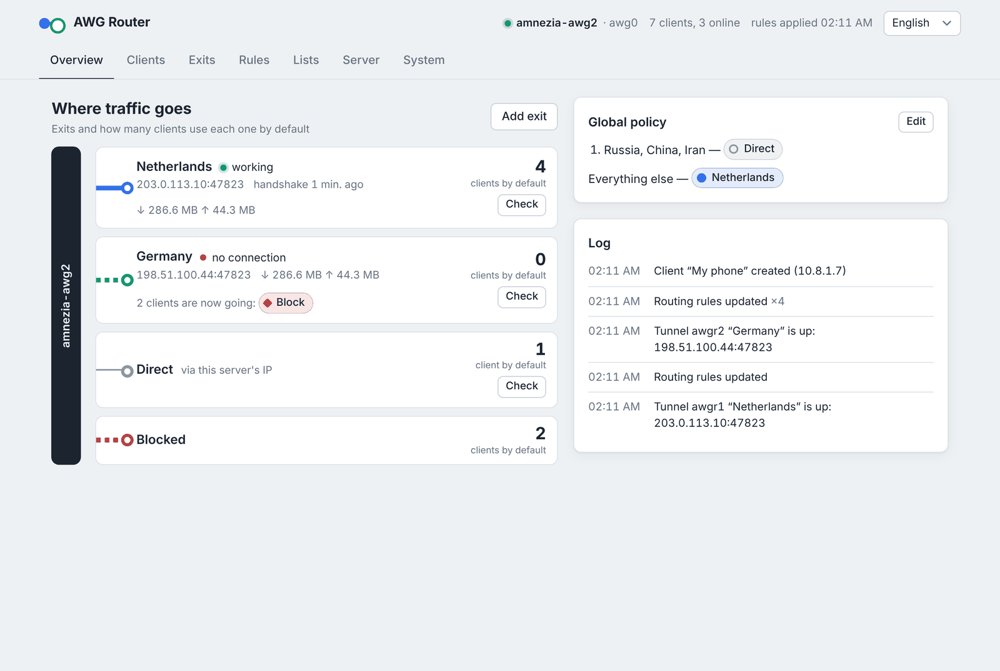
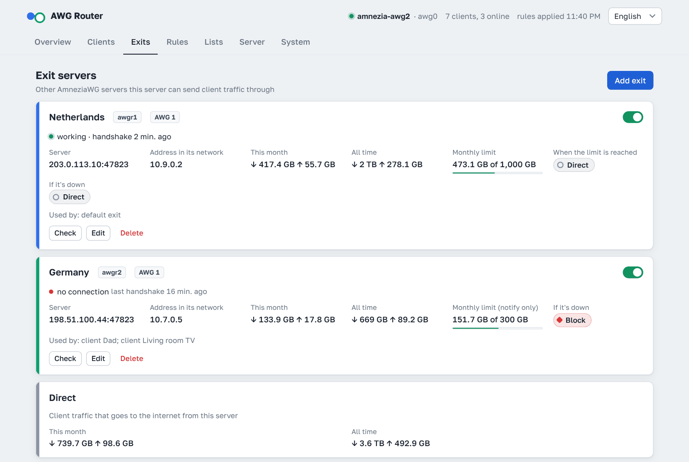
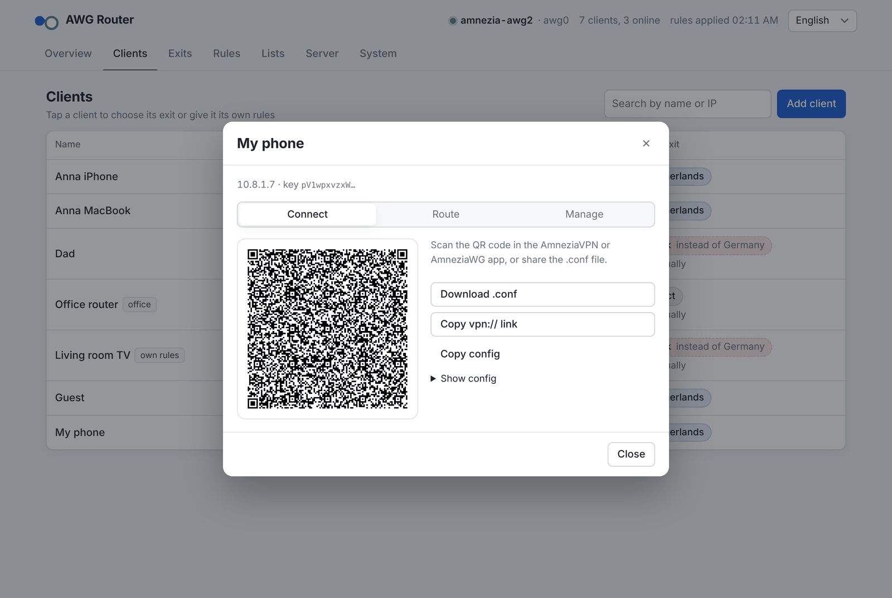
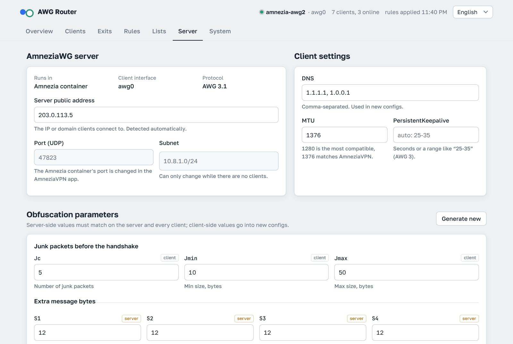

<p align="center">
  <b>English</b> · <a href="README.ru.md">Русский</a> · <a href="README.zh.md">中文</a> · <a href="README.fa.md">فارسی</a>
</p>

# AWG Router

A web panel for **AmneziaWG**: users, tunnel settings and cascade routing in one place.

It works with the server that the AmneziaVPN app installs (the `amnezia-awg2` Docker container), or installs its own AmneziaWG server on the host. Protocol support goes up to **AmneziaWG 3.1**.

```
                               ┌── RU / CN / IR ──────────► internet (this server's IP)
 clients ──AWG──► this server ─┤
                               ├── everything else ──AWG──► server #2 ──► internet
                               └── client "Dad" ─────AWG──► server #3 ──► internet
```

<p align="center">
  
</p>

## Features

**Clients**
- Add, rename, disable and delete clients.
- Connect a device with a QR code, a `.conf` file or a `vpn://` link for the AmneziaVPN app.
- Clients created in the AmneziaVPN app show up and can be managed too. The panel can't show their config, because the private key exists only on the device.
- A disabled client stays in the config as a comment, so nobody else takes its address.
- Traffic per client for the month and all time; it survives restarts. Sort by name, address, traffic or activity.
- An end date and a traffic limit (per month or in total). When they run out, the client turns off by itself; a monthly limit resets on the 1st and the client turns back on. Three days before the end date and at 90% of the limit you get a warning, and **Ending soon** in the client list shows who is close.
- A personal link: the person opens it, downloads their config or scans the QR code, and sees their traffic and end date — no panel sign-in.

**Server**
- Every AmneziaWG parameter: Jc/Jmin/Jmax, S1–S4, H1–H4, I1–I5, HeaderProtectionKey, ContentPaddingAddition, AWG 3 timings, RandomTrailers and DisableCookies.
- Ready-made masking for the signature packets I1–I5: STUN (calls, WebRTC), QUIC (HTTP/3), DNS query, SIP and a fixed DNS response for icloud.com (what AmneziaVPN puts in by default), with random parts so no two handshakes look alike. I1–I5 are checked strictly (only tags every AmneziaWG understands, packet size shown) and can be set per client: if a client's provider starts blocking, give that one client another masking.
- Fresh parameters on demand, generated the same way as the AmneziaVPN installer does for AWG 3.1.
- Port, subnet, client DNS/MTU/keepalive, public address and the address in client configs (IPv4 or IPv6).
- Adding or removing a client is applied live without dropping anyone. Server-side parameters restart the interface, which takes a few seconds.

**Routing**
- Exits are client configs from other AmneziaWG servers. If an exit fails, its traffic goes direct, gets blocked or moves to another exit, whichever you choose.
- Traffic per exit and direct for the month and all time, and each client's monthly traffic split by exit. An exit can have a monthly limit; when it is used up, its traffic until the 1st goes direct, gets blocked or moves to another exit, whichever you choose (or you only get a notification).
- Rules map a list of networks to an exit. Lists can be countries, autonomous systems (ASN), lists fetched from a URL, or your own subnets, and they refresh automatically.
- Each client can have its own exit and its own rules.
- **Route check** shows which way an IP or domain would go.

<p align="center">
  
</p>

**Panel**
- HTTPS with a Let's Encrypt certificate issued for the server's IP. The certificate lasts 6 days and renews itself.
- Alternatively, the panel can be reachable only through an SSH tunnel.
- The address uses a random port and a secret path, and login is password-protected with brute-force protection. A sign-in lasts 4 hours.
- Optional second factor: a 6-digit code from an authenticator app (Google Authenticator, Aegis, 2FAS…). Turned on in **System**.
- Optional Telegram notifications: an exit stops or recovers or nears its limit, the AmneziaWG server is unreachable or restarted, a client nears or hits its end date or limit, panel sign-ins, a certificate that can't be renewed, a new panel version. Set up in **System**.
- The password can be changed right in the panel.
- Backup and restore in one file: panel settings, exits, rules, client keys and the AmneziaWG server config — handy for moving to another server. The bot can also send a backup to Telegram every day or week, encrypted with a password if you set one.
- The panel shows its version, tells you when an update is out and updates itself with one button (or `awg-router update` on the server).
- Can be added to a phone's home screen and opens like an app.
- Languages: English, Russian, Chinese and Persian. The language follows the browser or system setting, and a manual choice is remembered.

<p align="center">
  
  
</p>

## Install

You need an **Ubuntu or Debian** server. Run this as root (if you log in as another user, run `sudo -i` first). If Docker is missing, the installer sets it up.

```bash
curl -fsSL https://raw.githubusercontent.com/r-slashslash/AWG-Router/main/install.sh | bash
```

The installer downloads the panel into `/opt/awg-router` and asks two questions:

1. **What to manage.**
   - If it finds an AmneziaVPN container, it offers to manage that container or a separate AmneziaWG server on the host.
   - If there's no AmneziaWG on the server, it offers to install one, either in a Docker container like AmneziaVPN does (the app will see it too) or directly on the host as a systemd service. It suggests a random UDP port.
2. **How to open the panel.** Choose a browser over HTTPS, or an SSH tunnel only.

The rest is automatic: a random 4-digit port, a password, the build, the certificate. At the end it prints the link and password:

```
  AWG Router is ready
  Link:     https://203.0.113.5:4721/3f9a1c2e7b6d/
  Password: Xk3vQ9mT2pLw8ZrA
  Let's Encrypt certificate valid until 2026-11-04 08:15, renews automatically
```

> **Firewall:** open TCP port **80** (used for a few seconds while Let's Encrypt validates) and the panel port. If your hosting provider has its own firewall in its control panel, open the ports there as well.

### The `awg-router` command

| Command | What it does |
|---|---|
| `awg-router info` | show the link and password |
| `awg-router update` | download the latest version and update (settings are kept) |
| `awg-router password` | set a new random password |
| `awg-router 2fa-off` | turn off the authenticator code (if you lost your phone) |
| `awg-router restart` | restart the panel |
| `awg-router logs` | show the panel log |
| `awg-router reconfigure` | choose the mode and access method again |
| `awg-router uninstall` | remove the panel and its routing rules; the AmneziaWG server and its clients stay |

### Access through an SSH tunnel

In this mode the panel isn't reachable from the internet. On your computer or phone (Termux), run:

```bash
ssh -N -L PORT:127.0.0.1:PORT root@SERVER_IP
```

Keep it running and open `http://127.0.0.1:PORT/secret-path/`. Run `awg-router info` to get the exact command and address.

## Certificate

Let's Encrypt issues certificates for IP addresses only with a 6-day lifetime (the `shortlived` profile).
- The panel gets the certificate with [lego](https://go-acme.github.io/lego/), validating over port 80, and renews it about every 3 days without a restart.
- If issuance fails, the panel runs with a temporary self-signed certificate, so the browser will show a warning. It retries every 30 minutes.
- Status and a **Get a certificate now** button are on the **System** tab.

If the server has a domain name, put `TLS_DOMAIN=example.com` into `/opt/awg-router/.env` and run `awg-router update`.

## Server modes

### AmneziaVPN container

The panel writes the config in the app's own format:
- a shared PSK;
- `clientsTable` with client names;
- I1–I5 kept as comments.

Clients added in the panel appear in the app, and vice versa.

Limitations:
- The container's port can only be changed in the AmneziaVPN app.
- If you change server-side parameters in the panel (S1–S4, H1–H4, header protection key), the app doesn't learn about it. New clients from the app won't connect until you re-check the server in the app, which reads the parameters back from the server.

If the AWG Router installer created the container, its configs live on the host in `/opt/awg-router/awg-server/data` and survive re-creating the container.

### AmneziaWG on the host

The panel installs `awg`, `awg-quick`, `amneziawg-go` (AWG 3.1) and the `awg-quick@awg0` service.
- The config is at `/etc/amnezia/amneziawg/awg0.conf`.
- NAT and forwarding are set up in `PostUp`, so the VPN keeps working even when the panel is stopped.

## How routing works

The panel runs in its own container (`network_mode: host`, `pid: host`, `privileged`) and enters the AWG server's network namespace with `nsenter`.
- Each exit gets a tunnel `awgrN` with its own routing table.
- Client packets are marked by nftables rules in the `ip awgr` table.
- The tunnel address on the exit server is applied with SNAT, so it never clashes with your clients.
- If a tunnel disappears, an `unreachable` route stays in its table, so traffic never leaks around the exit.

Everything that's applied is visible on the **System** tab under **What's applied right now**.

## Security

The panel effectively has root access to the server.
- The password is long and random, and the address includes a random port and a secret path.
- After 8 wrong passwords, logins from that IP are blocked for 10 minutes.
- The most locked-down option is access through an SSH tunnel only.
- Private keys of exits and of clients created in the panel are stored in `/opt/awg-router/data/state.json`, with permissions 600.

## Limitations

- Inside the tunnel, IPv4 only. Clients connect to the server over IPv4 or IPv6.
- Rules match IP networks, not domain names.
- Country lists are built from registry data. For a specific service, an ASN list is more accurate.

## Development

```bash
python3 -m unittest discover tests                                     # configs, nftables, parameters
sudo PYTHONPATH=<pyroute2>:. python3 tests/netns_e2e.py                 # routing in network namespaces
sudo PATH=<awg,amneziawg-go>:$PATH PYTHONPATH=<pyroute2>:. python3 tests/awg_real_e2e.py
                                                                        # a real AWG tunnel client ↔ server
DRY_RUN=1 PANEL_PASSWORD=demo DATA_DIR=./demo python3 -m app.main       # demo without a server
```

The panel has no Python dependencies outside the standard library. The Docker image adds `amneziawg-go`, `amneziawg-tools` and `lego`.

## Credits

- [AmneziaWG](https://github.com/amnezia-vpn) — the protocol, `amneziawg-go` and `amneziawg-tools`
- [lego](https://github.com/go-acme/lego) — Let's Encrypt client
- [ipverse](https://github.com/ipverse) — country and ASN IP lists
- [QR Code Generator](https://github.com/kazuhikoarase/qrcode-generator) by Kazuhiko Arase (MIT)

## License

[MIT](LICENSE)
