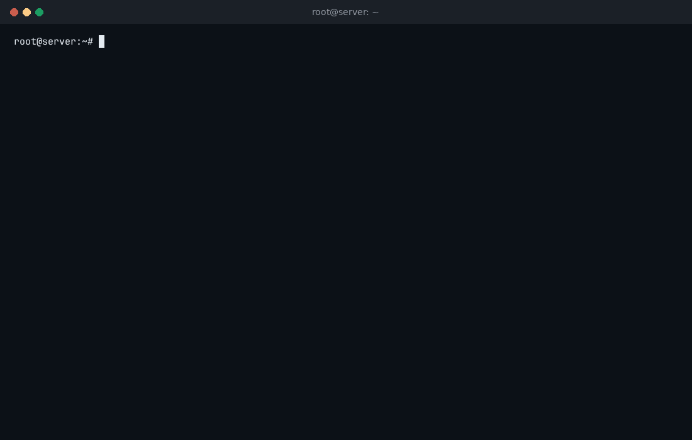
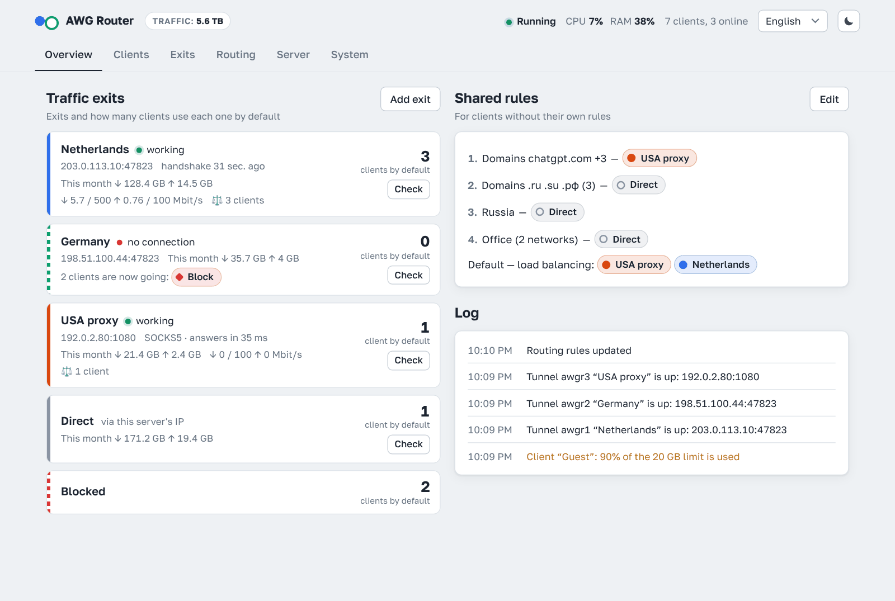
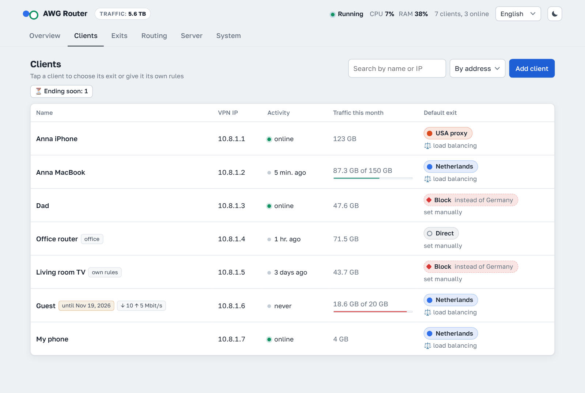
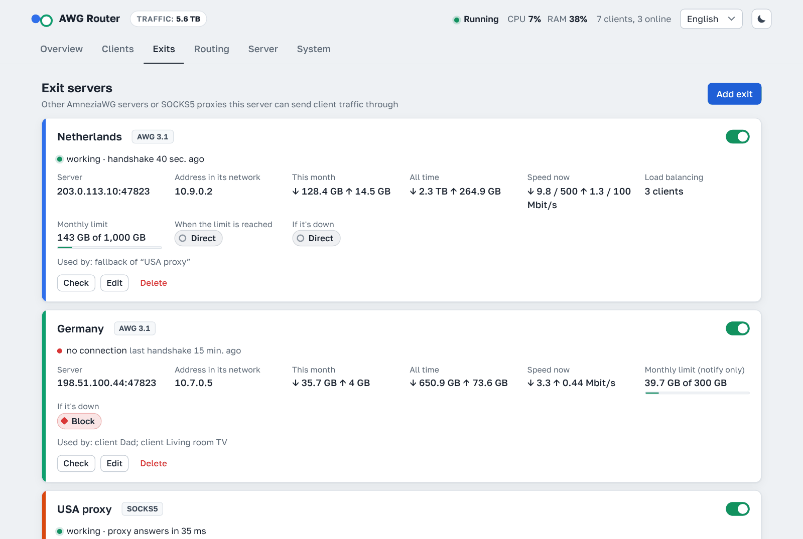
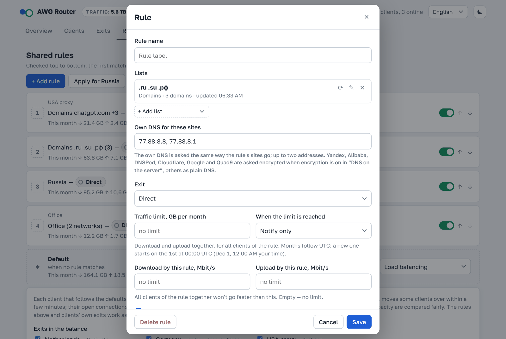
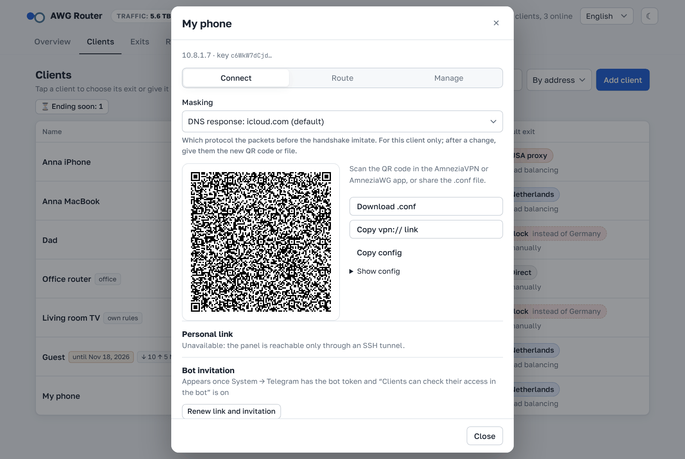
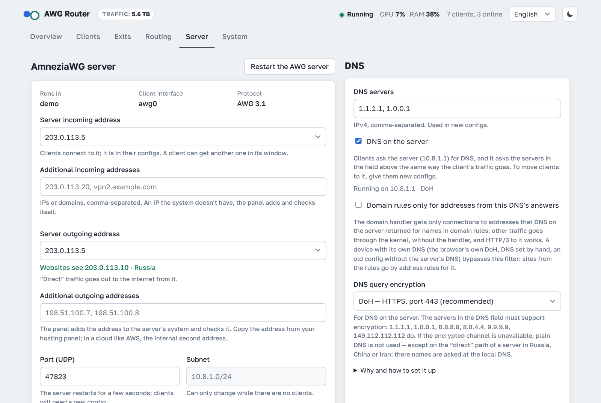
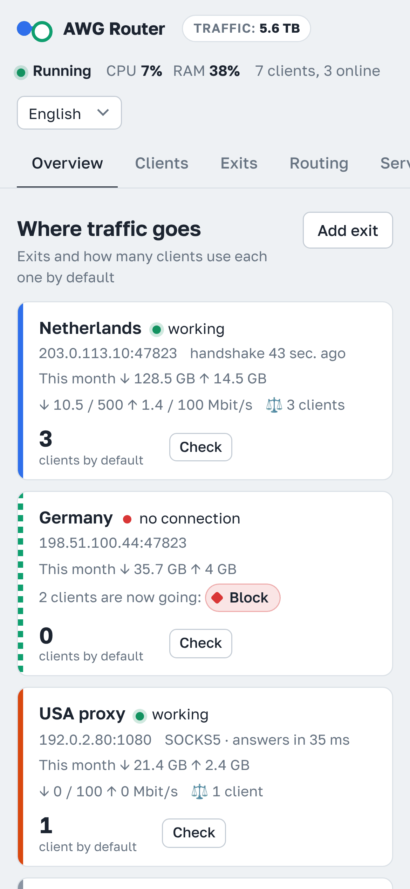

<p align="center">
  <a href="README.md">English</a> · <b>Русский</b> · <a href="README.zh.md">中文</a> · <a href="README.fa.md">فارسی</a>
</p>

<p align="center">
  <a href="https://github.com/r-slashslash/AWG-Router/releases/latest"></a>
  <a href="https://github.com/r-slashslash/AWG-Router/releases"></a>
  <a href="https://github.com/r-slashslash/AWG-Router/blob/main/LICENSE"></a>
  <br>
  <a href="https://github.com/r-slashslash/AWG-Router/actions/workflows/release.yml?query=branch%3Amain+event%3Apush"></a>
  <a href="https://github.com/r-slashslash/AWG-Router/actions/workflows/e2e.yml"></a>
  <br>
  <a href="https://github.com/r-slashslash/AWG-Router/attestations"></a>
  <a href="https://github.com/r-slashslash/AWG-Router/pkgs/container/awg-router"></a>
  
</p>

# AWG Router

Веб-панель для **AmneziaWG**: клиенты, настройки туннеля, каскадная маршрутизация и индивидуальная маршрутизация для каждого клиента.

Ставит свой сервер AmneziaWG — в Docker-контейнер или прямо на хост — или берёт под управление уже работающий, в том числе поставленный приложением AmneziaVPN (контейнер `amnezia-awg2`), со всеми его пользователями. Поддерживается протокол AmneziaWG до версии **3.1**.

**Быстрый старт** — на сервере с Ubuntu или Debian, от root (если Docker нет, установщик поставит его сам):

```bash
curl -fsSL https://raw.githubusercontent.com/r-slashslash/AWG-Router/main/install.sh | bash
```

Установщик настроит всё сам, включая Docker Compose, и в конце покажет ссылку на панель и пароль. Подробности: [Установка](#установка).

<p align="center">
  
</p>

```
                               ┌── RU / CN / IR ─────────► интернет (IP этого сервера)
 клиенты ──AWG──► этот сервер ─┤
                               ├── всё остальное ──AWG──► сервер №2 ──► интернет
                               └── клиент «Папа» ──AWG──► сервер №3 ──► интернет
```

<p align="center">
  
</p>

## Каскадный VPN (двойной VPN): российский трафик напрямую, остальное через зарубежный сервер

AWG Router делает ваш сервер AmneziaWG входом каскада. Клиенты подключаются только к нему, а сервер сам решает, откуда каждое соединение выйдет в интернет:
- российские сайты и сервисы открываются напрямую с входного сервера — с российского IP и без крюка через заграницу (банки, госуслуги и сервисы, которые не пускают иностранные адреса);
- весь остальной трафик идёт через второй сервер AmneziaWG (или прокси SOCKS5) за границей и выходит в интернет с его IP;
- выходов может быть несколько: разные списки на разные серверы или отдельный выход для одного клиента;
- деление трафика (сплит-туннелинг) настроено на сервере, конфиги клиентов обычные — на телефонах и роутерах ничего настраивать не нужно;
- список российских сетей обновляется сам, а выходы, списки и правила задаются в панели вместо ручных скриптов с iptables и ipset;
- если выход упал, трафик мимо него не утечёт: он пойдёт напрямую, заблокируется или уйдёт в другой выход — как выберете.

Резерв помогает, только когда он отказывает отдельно от основного выхода. Два выхода на один и тот же сервер — это один путь, а не два: если его адрес заблокируют целиком, прокси SOCKS5 поверх этого адреса и прямой AmneziaWG до него перестанут работать одновременно.

Поэтому в резерв лучше ставить выход на другом сервере — другой адрес, другой хостер, другая автономная система. И по возможности не обращаться к конечному серверу напрямую из страны с блокировками: если к нему ходят только из-за границы, его адрес там не виден.

Подробности — в разделе [Как устроена маршрутизация](#как-устроена-маршрутизация).

## Что умеет

**Клиенты**
- Добавить, переименовать, отключить, удалить.
- Конфиг для подключения: QR-код, файл `.conf`, ссылка `vpn://` для приложения AmneziaVPN.
- Клиенты, созданные в приложении AmneziaVPN, видны и управляются так же. Их конфиг панель показать не может: закрытый ключ есть только на устройстве.
- Отключённый клиент остаётся в конфиге закомментированным, поэтому его адрес никто не займёт.
- Трафик каждого клиента за месяц и за всё время, не сбрасывается при перезапусках. У клиента в сети в списке видна и скорость сейчас (загрузка и отдача). Сортировка по имени, адресу, трафику и активности.
- Общий трафик сервера за всё время — рядом с названием панели (не уменьшается при удалении клиентов).
- Строка состояния панели: сначала то, что панель сейчас делает: **«Работает»** (зелёный); **«Запуск…»**, **«Перезапуск сервера AWG…»**, **«Смена движка…»** или **«Обновление…»** (жёлтый, в том числе обновление, запущенное в консоли сервера); **«Ошибка»** или **«Нет связи с панелью»** (красный; в подсказке причина, по нажатию — переход к сообщениям наверху), затем загрузка процессора и памяти сервера (в подсказке — средняя нагрузка и сколько памяти занято), затем клиенты в сети.
- Если у сервера AmneziaWG пропал интерфейс, а контейнер продолжает работать (например, ядро завершило `amneziawg-go` из-за нехватки памяти), панель сама перезапускает сервер и сообщает об этом в Telegram. Вручную — **«Сервер» → «Перезапустить сервер AWG»**.
- Срок действия и лимит трафика (в месяц или всего). Когда они заканчиваются, клиент отключается сам; месячный лимит обнуляется 1-го числа в 00:00 UTC (панель показывает, когда это по вашему времени), и клиент включается снова. За 3 дня до конца срока и при 90% лимита приходит предупреждение, а фильтр **«Скоро закончатся»** в списке клиентов показывает, у кого срок или лимит на исходе.
- Ограничение скорости (выключено, пока не задано): общий предел для всех клиентов, личный предел клиента и предел выхода, загрузка и отдача отдельно. Внутри общего предела скорость делится поровну между теми, кто сейчас качает. Соединения не рвутся, интернет просто становится медленнее, а задержка под нагрузкой не растёт.
- Личная ссылка: человек открывает её, скачивает конфиг или сканирует QR-код и видит свой трафик и срок — без входа в панель. Ссылка есть с момента создания клиента, и тот же ключ — его приглашение в бота Telegram: там он видит то же и получает свой конфиг, больше ничего из панели; по желанию бот ещё и напоминает ему о сроке и лимите (**«Система» → «Telegram»**). Обе — в окне клиента, в разделе **«Подключение»**; **«Обновить»** там меняет обе.
- Светлая и тёмная тема, кнопка «день/ночь» в шапке. Во вкладке браузера — адрес сервера или название, которое вы ему дали (**«Система» → «Настройки» → «Название сервера»**), — удобно, когда открыто несколько серверов.

<p align="center">
  
</p>

**Сервер**
- Все параметры AmneziaWG: Jc/Jmin/Jmax, S1–S4, H1–H4, I1–I5, HeaderProtectionKey, ContentPaddingAddition, тайминги AWG 3, RandomTrailers, DisableCookies.
- Готовая маскировка для сигнатурных пакетов I1–I5: STUN (звонки, WebRTC), QUIC (HTTP/3), DNS-запрос, SIP и DNS-ответ про icloud.com с настоящим адресом Apple — со случайными частями, чтобы рукопожатия не были одинаковыми. Пакет, который по умолчанию ставит AmneziaVPN (одинаковый у всех, и icloud.com в нём указывает на адрес Яндекса), панель сама заменяет на этот. I1–I5 проверяются строго (только теги, которые понимает любой AmneziaWG, показан размер пакета) и задаются для отдельного клиента: если у него провайдер начал блокировать, выдайте только ему другую маскировку.
- Генерация новых параметров, как в установщике AmneziaVPN для AWG 3.1.
- Порт, подсеть, DNS/MTU/keepalive клиентов и **«Входящий адрес сервера»** — тот, что в конфигах клиентов (IPv4 или IPv6).
- **Адреса сервера — входящие и исходящие.** Входящие: другие IP или домены этого сервера, к которым подключаются клиенты. Любой из них можно поставить в конфиги всех клиентов или одного клиента (например, если у него заблокирован основной адрес). Исходящие: другие IPv4 этого сервера (скопируйте из панели хостинга; в AWS — внутренний второй адрес) — панель сама добавит их в систему сервера и проверит, что с каждого видят сайты. Тогда в выборе выхода у каждого адреса своё **«Напрямую»** (**«Напрямую — 198.51.100.7»**), а выход через другой сервер может подключаться с одного из них. **«Маршрутизация» → «Адреса сервера»** показывает каждый адрес и где он стоит; нажмите на адрес, чтобы отметить клиентов, правила и выходы. Если исходящий адрес перестал работать, всё, что шло через него, блокируется (с другого адреса не уходит), выход, который с него подключается, переходит на свой резерв, и приходит сообщение в Telegram. Сама панель (обновления, списки, сертификат) тоже может выходить с выбранного адреса (**«Система» → «С какого адреса выходит сам сервер»**), а если он перестал работать — с адреса системы.
- **DNS на сервере** (по желанию): клиенты спрашивают DNS у сервера, а он — серверы из настроек тем же путём, что и трафик клиента, с кэшем и шифрованием (DoH или DoT). Подробнее — в разделе [DNS на сервере](#dns-на-сервере).
- Добавление и удаление клиентов применяется на лету, остальные не отключаются. Серверные параметры применяются перезапуском интерфейса, это занимает несколько секунд.

**Маршрутизация**
- Выходы — это конфиги клиентов других серверов AmneziaWG или прокси SOCKS5 (`socks5://логин:пароль@адрес:порт`). Через SOCKS5 идёт и TCP, и UDP (если прокси умеет UDP ASSOCIATE); HTTP/3 (QUIC, UDP 443) — только с галочкой «Пропускать QUIC (HTTP/3) через прокси» в окне выхода, без неё браузеры сразу открывают сайты по HTTPS. Кнопка **Проверить** у выхода показывает, пропускает ли прокси UDP. Если выход упал, трафик на выбор идёт напрямую, блокируется или уходит в другой выход.
- Трафик по каждому выходу и напрямую за месяц и за всё время, а у каждого клиента — разбивка трафика за месяц по выходам. У выхода может быть месячный лимит; когда он исчерпан, его трафик до 1-го числа идёт напрямую, блокируется или уходит на другой выход — как выберете (или приходит только уведомление).
- Правила «список → выход». Списки бывают по странам, по автономным системам (ASN), по ссылке, из своих подсетей и из доменов и обновляются сами. Каждое правило настраивается в своём окне (**«Маршрутизация»** → **«+ Добавить правило»** или нажатие на правило): имя, списки — готовые, страна или новый, прямо в окне, — свой DNS у правила по доменам и выход. Отдельного раздела списков нет: список, который больше не стоит ни в одном правиле, удаляется вместе с ним.
- Правила по доменам на любой выход (AmneziaWG, SOCKS5, «напрямую» или «блок»): `example.com` в списке — это и все его поддомены, можно указать и целую зону (`.ru`, `.cn`, `.net`); можно вставить ссылку на готовый список (простой список доменов, dnsmasq, hosts, Adblock, v2ray). Сервер узнаёт сайт по имени в начале соединения HTTPS, HTTP или HTTP/3 (TCP 443 и 80, UDP 443). Через SOCKS5 имя передаётся прокси — адрес находит сам прокси, поэтому подмена DNS у провайдера не мешает; через AmneziaWG и «напрямую» соединение идёт к адресу, который устройство получило из своего DNS; DNS на сервере разбирает такие имена через выход правила — адрес не подменён и рядом с выходом. DNS и конфиги клиентов не меняются. Такие правила проверяются раньше правил по адресам.
- Правило в политике читается как «что ловит → куда»: слева его списки (`Домены work (20)`, свои сайты выхода — по первому домену `youtube.com +19`, `Россия, Китай +1`, `Офис (12 сетей)`), затем выход — на широком экране сразу за ними, на телефоне у правого края, и если выход не влезает рядом со списками, видно только первый и `+N`; своё название правила — мелкой серой строкой над ним; выключенное правило остаётся на месте, серым и зачёркнутым.
- В окне выхода сначала выбирается тип (AmneziaWG или SOCKS5). Для SOCKS5 есть отдельные поля адреса, порта, логина и пароля (из них собирается строка подключения, а вставленная строка сама раскладывается по полям). Для обоих типов маршрутизация через этот выход настраивается в том же окне: сайты (домены), списки доменов и сетей или весь трафик. Сохраняется как обычные общие правила; выключенные правила, их подписи и порядок не меняются.
- У каждого клиента может быть свой выход и свои правила: они заменяют общие и настраиваются в том же окне правила. Все они собраны и в разделе **«Маршрутизация» → «Правила клиентов»**: там их можно добавлять, менять и удалять.
- **Балансировка** (по желанию) вместо выхода по умолчанию: каждый клиент получает самый свободный из выбранных выходов; загрузка считается от ограничения скорости выхода, если оно задано. Если один выход перегружен, а другой простаивает, часть клиентов через несколько минут переходит на другой, не теряя открытых соединений; клиенты упавшего выхода переходят сразу. Правила и личные выходы клиентов работают как раньше.
- **Балансировка внутри правила**: выберите выходом правила **«Балансировка»** и отметьте выходы — клиенты правила распределятся по ним так же. Если не работает ни один, трафик правила блокируется (или идёт туда, куда выберете).
- **Трафик по правилам**: под каждым правилом и под **«По умолчанию»** на **«Маршрутизации»** — сколько все его клиенты скачали и отдали за месяц; в окне клиента — его трафик по каждому правилу (за этот месяц и прошлый). В окне правила видно, кто больше всех потратил по нему за месяц.
- У правила может быть **месячный лимит трафика** на всех его клиентов вместе: когда он исчерпан, до 1-го числа трафик правила идёт напрямую, блокируется или уходит на другой выход — как выберете (или приходит только уведомление). И **ограничение скорости**, загрузки и отдачи отдельно, тоже на всех его клиентов вместе. Свои правила клиента начинаются с копии общих — без этих ограничений. Уже открытое соединение держит то ограничение скорости, с которым началось, пока не переподключится.
- «Проверка маршрута» показывает, куда пойдёт трафик до нужного IP или домена.

<p align="center">
  
  
</p>

**Панель**
- HTTPS с сертификатом Let's Encrypt на IP-адрес или ваш домен, который продлевается сам, или со своим сертификатом (например, от certbot). Если порт 80 уже занят nginx или Apache, проверка идёт через них; домен, DNS которого в Cloudflare, можно проверить через Cloudflare — без порта 80.
- Можно вместо этого входить только через SSH-туннель.
- В адресе случайный порт и секретный путь, вход по паролю, есть защита от подбора. Вход действует 4 часа.
- По желанию — второй фактор: 6-значный код из приложения-аутентификатора (Google Authenticator, Aegis, 2FAS…). Включается на вкладке **«Система»**.
- По желанию — уведомления в Telegram: выход перестал или снова начал работать или подходит к лимиту, исходящий адрес сервера перестал или снова начал работать, сервер AmneziaWG недоступен или перезапустился, память сервера долго занята больше чем на 90% или процессор — больше чем на 95%, у клиента скоро закончится или закончился срок или лимит, новый клиент подключился впервые, вход в панель, не продлевается сертификат, вышла новая версия, а с галочкой — итоги прошлого месяца 1-го числа (сервер, выходы и правила). Настраиваются на вкладке **«Система»**. Там, где Telegram заблокирован (Россия, Китай, Иран), бот может отправлять сообщения через один из ваших выходов; если выбранный путь не работает, бот пробует другие (галочка **«Если не получается — пробовать другие пути»**, включена сразу): с «Напрямую» — ваши выходы по очереди, с выхода — другие выходы, но никогда не напрямую. Найденный путь держится, выбранный пробуется снова раз в 10 минут; если не работает ничего, сообщения ждут появления связи. Это касается всего, что делает бот: уведомлений, управления, сообщений клиентам и копий. **«Включить бот»** — главный выключатель: выключен — бот молчит совсем.
- По желанию — управление из Telegram: бот становится пультом: `/start` открывает меню в одном сообщении — картинку с адресом VPN-сервера, сколько выходов онлайн, версией панели, клиентами, сколько из них в сети, и общим трафиком (**«Обновить»** рисует её заново), — и всё управление идёт в нём же, с кнопкой «‹ Меню» для возврата. В **«Сервере»** — состояние, тоже картинкой (работает ли сервер, версии, IPv4 и IPv6, DNS на сервере, время работы, RAM, трафик за месяц) и выходы (нажатый выход можно проверить или сделать основным); **«Клиенты»** начинаются с кнопки **«Новый клиент»**. А ещё: включить, выключить или удалить клиента (с подтверждением), его QR-код и файл конфига, +30 дней или +10 ГБ, новый клиент командой `/add`, проверка выхода и смена основного, куда пойдёт трафик до адреса, резервная копия, ссылка на панель и обновление панели. Кнопки появляются и под уведомлениями (например, «+30 дней» под «истёк срок»). Бот слушается только чат с числовым Chat ID, указанным в панели (@имя потом может занять другой человек); команду из другого чата бот не выполняет, а в личном чате отвечает на неё номером этого чата.
- Пароль можно сменить прямо в панели.
- Резервная копия и восстановление одним файлом: настройки панели, выходы, правила, ключи клиентов и конфиг сервера AmneziaWG — удобно для переезда на другой сервер. Свои адреса сервера (входящие, исходящие, адрес панели) и его название остаются как на том сервере, где восстанавливаете: после переустановки впишите их до восстановления. При скачивании файл можно зашифровать паролем. Бот может присылать копию в Telegram каждый день или раз в неделю, зашифрованную паролем, если он задан.
- Панель показывает свою версию, сообщает о выходе обновления и обновляется одной кнопкой (или командой `awg-router update` на сервере). Ставится только опубликованная версия, а её архив сверяется с контрольной суммой.
- Панель можно установить на телефон: «Система» → «Установить на телефон» покажет QR-код и как добавить её на главный экран, откуда она откроется как приложение.
- Языки: русский, английский, китайский, фарси. Язык выбирается по языку браузера или системы, выбранный вручную запоминается.

<p align="center">
  
  
</p>

<p align="center">
  
</p>

## Установка

Нужен сервер на **Ubuntu 20.04+ или Debian 11+** (для модуля ядра — 22.04+ или 12+), x86_64 или arm64; если нет `curl`: `apt-get install -y curl`. Команду выполняйте от root (если входите под другим пользователем, сначала выполните `sudo -i`). Docker установщик поставит сам, если его нет.

```bash
curl -fsSL https://raw.githubusercontent.com/r-slashslash/AWG-Router/main/install.sh | bash
```

Установщик скачает панель в `/opt/awg-router`. Он говорит по-английски и задаст несколько вопросов:

1. **Чем управлять.**
   - Если найден контейнер AmneziaVPN, предложит управлять им или отдельным сервером AmneziaWG на хосте.
   - Если AmneziaWG на сервере нет, предложит установить. Можно в Docker-контейнер, как это делает AmneziaVPN, и тогда приложение тоже увидит сервер. Или прямо на хост, службой systemd. UDP-порт предложит случайный.
2. **Как заходить в панель:** через браузер по HTTPS или только через SSH-туннель.
3. **Движок** (только если сервер может взять модуль ядра). Enter — модуль ядра (см. [Движок AmneziaWG](#движок-amneziawg)).
4. **Порт панели.** Enter — случайный свободный 4-значный.
5. **Домен панели** (только для браузера). Enter — панель открывается по IP; домен должен указывать на этот сервер.

Если порт 80 уже занят nginx или Apache, установщик покажет маленький файл, который может добавить туда для проверки Let's Encrypt, и спросит, прежде чем добавлять (см. [Порт 80 занят веб-сервером](#порт-80-занят-веб-сервером)).

Остальное установщик сделает сам: сгенерирует пароль, поставит образ панели и получит сертификат. Образ скачивается готовым из реестра GitHub (ghcr.io), поэтому серверу не нужно обращаться к источникам Alpine и GitHub, которые в некоторых странах фильтруются; если скачать не удалось, образ собирается на сервере, как раньше (`AWGR_BUILD=1` — всегда собирать). В конце покажет ссылку и пароль:

```
  AWG Router is ready
  Link:     https://203.0.113.5:4721/3f9a1c2e7b6d/
  Password: Xk3vQ9mT2pLw8ZrA
  Let's Encrypt certificate valid until 2026-11-04 08:15, renews automatically
```

> **Фаервол:** откройте UDP-порт AmneziaWG (в панели **«Сервер» → «Порт (UDP)»**), TCP-порт **80** (он нужен на несколько секунд, пока Let's Encrypt проверяет сервер) и порт панели. Если у хостинга есть свой фаервол в личном кабинете (AWS, Oracle, Google Cloud…), откройте их и там: без UDP-порта панель откроется, а клиенты не подключатся.

### Если что-то не работает

- Панель не открывается: проверьте фаервол (выше) и точную ссылку — `awg-router info`.
- Журнал: `awg-router logs` (выход — Ctrl+C). Если первая установка остановилась с ошибкой, команды `awg-router` ещё нет: запустите команду установки ещё раз или посмотрите `docker logs awg-router` и `/opt/awg-router/data/*.log`.
- Клиенты не подключаются: UDP-порт должен быть открыт и в фаерволе хостинга.
- В issue укажите версию, режим сервера и журнал (уберите пароли и ключи).

### Команда `awg-router`

| Команда | Что делает |
|---|---|
| `awg-router info` | показать ссылку и пароль |
| `awg-router update` | скачать новую версию и обновиться (настройки сохраняются) |
| `awg-router password` | сменить пароль на новый случайный |
| `awg-router 2fa-off` | выключить вход по коду из приложения (если потеряли телефон) |
| `awg-router restart` | перезапустить панель |
| `awg-router logs` | журнал панели |
| `awg-router reconfigure` | заново выбрать режим и способ входа; можно и перенести сервер AmneziaWG из контейнера на хост с теми же ключами, портом и клиентами |
| `awg-router install-kernel` | собрать и загрузить модуль ядра AmneziaWG (см. [Движок AmneziaWG](#движок-amneziawg)) |
| `awg-router uninstall` | удалить панель и её правила маршрутизации; спрашивает, оставить ли установленный ею сервер AmneziaWG (по умолчанию остаётся; его ключи лежат в `/opt/awg-router/awg-server`, поэтому, пока он работает, папку не удаляйте), затем — удалить ли и настройки панели в `/opt/awg-router` (по умолчанию остаются, и новая установка их подхватит; пока там ключи оставленного сервера, вопроса нет) |

### Возврат на прошлую версию

От root (в оболочке root: `sudo` с переменной перед ним её теряет):

```bash
AWGR_SRC_URL=https://github.com/r-slashslash/AWG-Router/releases/download/vX.Y.Z/awg-router.tar.gz awg-router update
```

Настройки, клиенты и резервные копии остаются. Архив, заданный так, с контрольной суммой не сверяется. Чего прошлая версия не знает — в заметках к той версии, с которой уходите, раздел «Возврат». `awg-router update` без переменной снова ставит последнюю версию.

### Вход через SSH-туннель

В этом режиме панель не видна из интернета. На телефоне (Termux) или компьютере выполните:

```bash
ssh -N -L ПОРТ:127.0.0.1:ПОРТ root@IP-СЕРВЕРА
```

Не закрывая это окно, откройте в браузере `http://127.0.0.1:ПОРТ/секретный-путь/`. Точную команду и адрес покажет `awg-router info`.

## Сертификат

- Панель получает сертификат Let's Encrypt через [lego](https://go-acme.github.io/lego/) на IP сервера или домен панели, с проверкой по порту 80, и продлевает его без перезапуска. На IP-адрес Let's Encrypt выдаёт сертификаты только на 6 дней (профиль `shortlived`), поэтому панель продлевает его примерно раз в 3 дня.
- **«Система» → «Адрес панели»** — IP или домен, по которому открывается панель и на который выдаётся сертификат; **«Система» → «Настройка сертификата»** — выбор между Let's Encrypt и своим сертификатом. Для своего укажите пути на сервере к сертификату (с цепочкой) и ключу, например от certbot: `/etc/letsencrypt/live/example.com/fullchain.pem` и `privkey.pem`. Панель проверит, что сертификат выдан на адрес панели и ключ к нему подходит; когда certbot продлит сертификат, панель подхватит новый за несколько минут.
- **Через Cloudflare** (для домена, DNS которого в Cloudflare): в том же окне выберите **«Как подтвердить домен» → «Через Cloudflare»** и вставьте API-токен Cloudflare с правами **Zone → Zone → Read** и **Zone → DNS → Edit** только для этого домена (в Cloudflare: **My Profile → API Tokens → Create Token**). Let's Encrypt тогда проверяет запись TXT, которую панель добавляет через API Cloudflare, поэтому порт 80 и веб-сервер не нужны. Панель проверяет токен перед сохранением; токен хранится только на этом сервере (`data/tls.json`, доступен только root), в резервную копию не входит и удаляется, когда вы возвращаетесь к порту 80. Такие сертификаты — обычные, на 90 дней. Это только получение сертификата: у записи домена в Cloudflare должно быть **DNS only** (серое облако) — за прокси Cloudflare (оранжевое облако, у новой записи оно по умолчанию) панель по домену не откроется.
- Когда IPv6 в ходу (IPv6 в **«Адресе панели»** или выбран **«Входящим адресом сервера»**), сертификат выписывается сразу на IPv4 и IPv6 сервера, и панель открывается без предупреждения по любому из них. Если Let's Encrypt не смог проверить второй адрес (например, порт 80 по нему закрыт), сертификат будет на основной, а второй панель попробует снова через сутки. Через веб-сервер на порту 80 сертификат выписывается только на основной адрес.
- Адрес панели — только для панели: в конфигах клиентов — **«Входящий адрес сервера»** с вкладки **«Сервер»**, и смена одного не меняет другой. Установщик предлагает поставить в конфиги и домен панели.
- Если получить сертификат не удалось, панель работает с временным самоподписанным, и браузер покажет предупреждение. Попытки повторяются каждые 30 минут.
- Статус — на вкладке **«Система»**, кнопка **«Получить сертификат сейчас»** — в окне **«Настройка сертификата»**.

### Порт 80 занят веб-сервером

Если на сервере уже работают сайты на nginx или Apache, Let's Encrypt проверяет панель через них. Установщик и **«Система» → «Настроить проверку через веб-сервер»** сначала показывают файл и добавляют его, только если вы согласны:
- nginx (а также Angie и OpenResty) на хосте или в Docker, если папка его конфигов подключена с хоста: `awg-router-acme.conf` рядом с вашими конфигами (`conf.d`, `sites-enabled`). Apache на хосте: сайт `awg-router-acme.conf`.
- Файл отвечает только на `/.well-known/acme-challenge/` и только для адреса панели, из папки `/var/lib/awg-router/acme`. Ваши сайты и другие файлы настроек не меняются.
- Перед перезагрузкой конфиг проверяется (`nginx -t`, `apachectl configtest`), потом панель запрашивает через веб-сервер проверочный файл. При любой ошибке файл удаляется, и веб-сервер возвращается к прежним настройкам.
- Caddy, другие веб-серверы и контейнеры, у которых конфиг внутри образа: панель показывает блок, который нужно вставить вручную, а потом нажать **«Проверить»**.
- **«Убрать из веб-сервера»** и `awg-router uninstall` удаляют файл.

## Режимы сервера

### Контейнер AmneziaVPN

Панель пишет конфиг в формате приложения:
- общий PSK;
- `clientsTable` с именами клиентов;
- I1–I5 в комментариях.

Клиенты, добавленные в панели, видны в приложении, и наоборот.

Ограничения этого режима:
- При смене порта в панели контейнер пересоздаётся с теми же файлами и новым портом; VPN прерывается на несколько секунд. У клиентов, созданных в приложении, ключ есть только на устройстве: после смены им нужен новый порт в их конфиге или новый клиент из панели.
- В контейнере, созданном приложением AmneziaVPN, нельзя поменять и подсеть: приложение вписывает её в скрипт запуска контейнера.
- Если в панели изменить серверные параметры (S1–S4, H1–H4, ключ защиты заголовков), приложение об этом не узнает. Новые клиенты из приложения не подключатся, пока вы не выполните в приложении повторную проверку сервера: оно перечитает параметры с сервера.
- После перезагрузки сервера контейнер, созданный приложением AmneziaVPN, запускается раньше панели и без её правил: несколько секунд, пока панель не запустится, клиенты идут напрямую, мимо выходов. Свой контейнер панели и сервер на хосте ставят правила панели ещё до запуска VPN. Если это важно, перенесите сервер на хост командой `awg-router reconfigure` (те же ключи, порт и клиенты).

Если контейнер ставил установщик AWG Router, конфиги лежат на хосте в `/opt/awg-router/awg-server/data` и переживают пересоздание контейнера.

### AmneziaWG на хосте

Панель ставит на хост `awg`, `awg-quick`, `amneziawg-go` (AWG 3.1) и службу `awg-quick@awg0`.
- Конфиг: `/etc/amnezia/amneziawg/awg0.conf`.
- NAT и правила пересылки добавляются через `PostUp`, поэтому VPN работает, даже когда панель остановлена. При смене подсети панель переносит NAT на новую.

## Движок AmneziaWG

AmneziaWG работает либо модулем ядра Linux, либо программой `amneziawg-go`.

- **Модуль ядра** (рекомендуется) шифрует внутри ядра и расходует в разы меньше системных ресурсов, скорость выше. Особенно это заметно на слабом VPS с многими клиентами и в каскаде, где каждый пакет шифруется дважды (на сервере и в туннеле к выходу). Модуль собирается под ваше ядро (DKMS) и сам пересобирается при его обновлении. Нужны Ubuntu 22.04+ или Debian 12+ (в том числе с ядром 7.x), x86_64 или aarch64 и VPS не на OpenVZ/LXC.
- **amneziawg-go** работает на любом сервере, в том числе на OpenVZ/LXC, и приходит вместе с панелью, но шифрование забирает заметную долю системных ресурсов.

Как поставить модуль:
1. При новой установке установщик сам спрашивает, какой движок поставить, если сервер подходит; Enter — модуль. Ответить заранее: `AWGR_ENGINE=kernel` или `AWGR_ENGINE=go`.
2. На уже установленной панели — кнопка **«Установить модуль»** (в оповещении сверху или в **«Сервер» → «Движок AmneziaWG»**) или на сервере `sudo awg-router install-kernel`. Модуль собирается из PPA Amnezia, проверяется, что он 3.x (более старый удаляется), и загружается при старте системы (`/etc/modules-load.d/amneziawg.conf`). Затем панель предложит перезапустить сервер AWG: он сам возьмёт модуль (awg-quick предпочитает ядро).
3. Туннели к выходам идут следом за сервером: тоже на модуле, выбирать ничего не нужно. Чтобы выходы работали на одном движке независимо от сервера (например, чтобы смотреть журналы amneziawg-go при разборе проблемы), задайте `EXIT_ENGINE=go` или `EXIT_ENGINE=kernel` в `/opt/awg-router/.env` и выполните `cd /opt/awg-router && docker compose up -d` (`awg-router restart` изменения в `.env` не применяет).

Если с модулем что-то не так, сервер остаётся на связи:
- модуль не собрался или не загрузился — установщик или кнопка сообщают об этом, сервер работает на amneziawg-go;
- после обновления ядра модуль перестал загружаться — сервер сам поднимается на amneziawg-go, панель пишет об этом (и в Telegram) и предлагает поставить модуль снова;
- сервер не поднялся на модуле после двух перезапусков — панель отключает модуль, переводит сервер на amneziawg-go и сообщает об этом; кнопка **«Попробовать снова»** возвращает модуль;
- модуль не запустил туннель к выходу — выходы работают на amneziawg-go до следующего перезапуска сервера.

Установка модуля ещё и включает `kernel.panic = 10`, если у вас не задано своё значение: при сбое в ядре сервер перезагрузится сам, а не зависнет. **«Сервер» → «Движок AmneziaWG»** показывает, чем работает сервер и какой модуль загружен. Приложение AmneziaVPN может само поставить модуль ядра; если он старше 3.x, а сервер с параметрами AWG 3.1, панель предупредит (и в Telegram). Переключить движок вручную — **«Движок»** в том же блоке: amneziawg-go перезапускает сервер AWG без модуля (модуль остаётся установленным, но не загружается), модуль ядра загружает его снова (или сначала ставит) и перезапускает сервер; клиенты переподключаются за несколько секунд. Удалить модуль совсем: `apt remove amneziawg-dkms && rm -f /etc/modules-load.d/amneziawg.conf`, затем перезагрузить сервер.

## DNS на сервере

Включается на вкладке **«Сервер» → «DNS» → «DNS на сервере»**, по умолчанию выключено. Похоже на AmneziaDNS из приложения AmneziaVPN, но устроено с учётом каскада.

**Как работает.** Панель запускает в сети сервера AWG небольшой DNS-сервер (`dnsproxy.py`, порт 53 на адресе сервера в туннеле, например `10.8.1.1`). Клиенты получают его адрес в строке `DNS` конфига, вторым — первый сервер из поля «DNS». Сервер не ищет имена сам, а пересылает запрос серверам из поля «DNS» — **через основной выход этого клиента** (если выход не работает — через его резервный путь, как и трафик). Ответы кэшируются на время их TTL отдельно для каждого выхода, поэтому повторный запрос не идёт через каскад.

**Любой запрос DNS.** Пока он включён, сервер отвечает и на запросы клиентов к любому другому серверу DNS — ко второму DNS из конфига, к DNS, вписанному в устройство или приложение, к частному адресу: ни одно имя не уходит мимо выхода и без шифрования, а конфиги, выданные раньше, продолжают работать.

**Шифрование.** Запросы к серверам из поля «DNS» шифруются — настройка **«Шифрование запросов DNS»**:
- **DoH** (по умолчанию) — DNS поверх HTTPS, порт 443, по HTTP/2 или HTTP/1.1 — как выберет сервер. Выглядит как обычный HTTPS, его труднее всего заблокировать;
- **DoT** — DNS поверх TLS, порт 853;
- **без шифрования** — обычный DNS.

С шифрованием ни провайдер входного сервера, ни провайдер выхода не видят, какие сайты открывают клиенты, и не могут подменить ответ: сертификат сервера проверяется. TLS-соединения держатся открытыми, поэтому рукопожатие не повторяется на каждый запрос. Серверы из поля «DNS» должны поддерживать шифрование: подходят `1.1.1.1`, `1.0.0.1` (Cloudflare), `8.8.8.8`, `8.8.4.4` (Google), `9.9.9.9`, `149.112.112.112` (Quad9). Если зашифрованный канал недоступен, открытый DNS вместо него не используется: клиент спросит второй DNS из конфига, а панель покажет «Серверы DNS не отвечают». Исключение — **«Запасной DNS для «Напрямую»»** (**«Сервер» → «DNS»**, по умолчанию выключен): когда серверы DNS не отвечают на пути «напрямую» — в России, Китае и Иране зашифрованное соединение с ними часто режут, — имена клиентов, которые идут напрямую, спрашиваются у него, с того же исходящего адреса и ровно так, как он вписан (обычный, DoH или DoT); вкладка «Сервер» говорит, когда он используется. Одно медленное имя или один потерянный пакет его не включают: панель сначала проверяет серверы DNS (когда они отвечают — за доли секунды); там, где шифрованное соединение правда режут, запасной включается так же быстро, как раньше. Пути через выход так не делают никогда.

**Подвох каскада.** Резолвер на входном сервере, который спрашивает интернет прямо оттуда (так работает AmneziaDNS), получает ответы «глазами» страны входа. CDN по адресу резолвера решают, где клиент, и выдают узлы рядом с входным сервером, хотя трафик уходит через выход в другой стране: сайты и видео открываются медленно, а сервисы с проверкой региона могут отказать. AmneziaDNS шифрует запросы, поэтому провайдер не подменит ответы, но может заблокировать само зашифрованное соединение.

Здесь запрос идёт тем же путём, что и трафик клиента, поэтому у клиентов, которые выходят через другой сервер, ответы правильные для их страны. У клиентов, у которых основной путь — «напрямую», запросы уходят прямо с входного сервера, как у AmneziaDNS. Для них это правильно: их трафик уходит оттуда же, а шифрование защищает запросы от провайдера.

**Имена из правил по доменам.** Имя из списка правила по доменам разрешается через выход этого правила (с его резервным, как и трафик), а не через основной выход клиента: адрес — рядом с выходом, через который пойдёт соединение, и провайдер не может его подменить. У правила «напрямую» запрос уходит прямо с сервера, у правила «блок» — обычным путём клиента. С галочкой **«Правила по доменам — только для адресов из ответов этого DNS»** к обработчику доменов идут только соединения к адресам, которые этот DNS выдал на такие имена; остальной трафик этих клиентов остаётся в ядре. Новый адрес попадает в этот список раньше, чем ответ дойдёт до устройства, поэтому уже первое соединение к нему идёт по правилу, и остаётся в нём, пока устройства спрашивают этот сайт (кроме короткого времени, пока панель применяет изменённые правила).

Ограничения:
- клиент с блоком получает отказ;
- на запрос адреса IPv6 (AAAA) ответ — «записей нет»: туннель несёт только IPv4, и приложения сразу идут по IPv4;
- правила по адресам (например, «российские сети напрямую») на DNS не влияют: имена таких сайтов тоже разрешаются через основной выход клиента, и CDN может выдать для них зарубежный узел;
- сервер только пересылает запросы и не проверяет подписи DNSSEC сам — это делают серверы из поля «DNS»;
- свой AdGuard Home в поле «DNS» по умолчанию отвечает одному адресу не больше 20 запросов в секунду (**Rate limit** в его настройках DNS), а все запросы панели идут с одного адреса: на сервере с большим числом клиентов поднимите предел или поставьте 0;
- пока панель перезапускается или обновляется, имена несколько секунд не разрешаются; пока она остановлена — до запуска (с **«Когда панель останавливают» → «Вернуть всё напрямую»** запросы идут к тем серверам, к которым их отправили);
- в режиме «AWG на хосте» с файрволом только на nftables (например, firewalld) разрешите вход на порт 53 (UDP и TCP) с интерфейса клиентов; для iptables и ufw панель делает это сама.

**Свой DNS правила по доменам.** У правила по доменам может быть свой DNS-сервер (один-два: IPv4 — обычный DNS, `https://…/dns-query` — DoH, `h3://…/dns-query` — DoH только по HTTP/3 (он идёт по UDP, и провайдер может резать его отдельно от HTTPS — вторым адресом впишите `https://`; его отдают Google, Cloudflare и Alibaba, AdGuard отвечает не из любой сети, а Quad9 и Яндекс — нет), `tls://…` — DoT, **«Маршрутизация» → правило → «Свой DNS для этих сайтов»**): имена из его списков спрашиваются у него — тем же путём, что идут сайты правила, ровно так, как он вписан, — а всё остальное у обычных серверов. Например, российские сайты (`.ru`, `.su`, `.рф` в списке) — напрямую и у DNS Яндекса (`77.88.8.8`), китайские — у Alibaba (`223.5.5.5`), остальное — через выход у `1.1.1.1` по DoH. Местный DNS узнаёт только о местных сайтах. Так умеют только списки доменов: список адресов DNS-сервер выбрать не может — адрес становится известен только из ответа DNS. **Готовые правила** (для каскада, когда всё остальное идёт через выход)**:** пока правил нет, в **«Обзор» → «Общие правила»** есть **«Применить для России / Китая / Ирана»**: адреса и домены страны (`.ru`, `.su`, `.рф`; `.cn`, `.中国`, `.中國`; `.ir`, `.ایران`) идут напрямую, домены — со своим DNS этой страны, он же становится запасным DNS, и включается DNS на сервере (если клиенты уже выданы, сначала спросит: в их конфигах прежний DNS, пока их не импортируют заново). Повторное нажатие снова делает правила страны как при первом («Напрямую», включены, нынешний DNS страны, в конце); ограничения скорости и месячные лимиты остаются. На **«Маршрутизации»** эти кнопки есть всегда, рядом с **«+ Добавить правило»**. Новая установка начинается без правил. Адрес самого DNS на сервере своим DNS правила быть не может: он ничего не дал бы.

**Как лучше пользоваться.**
1. Оставьте шифрование **DoH**, а в поле «DNS» — серверы, которые его поддерживают, например `1.1.1.1, 8.8.8.8`. Серверы местного провайдера не подходят: запросы к ним всё равно пойдут через выход, а шифрование они обычно не умеют.
2. Включайте, если у большинства клиентов основной путь — через выход.
3. После включения или выключения отдайте клиентам новые конфиги (QR-коды или файлы): старые продолжают спрашивать прежние DNS.
4. Отдельный AmneziaDNS при этом не нужен; если он установлен, панель его не трогает.

## Как устроена маршрутизация

Панель работает в отдельном контейнере (`network_mode: host`, `pid: host`, `privileged`) и через `nsenter` входит в сеть сервера AWG.
- Для каждого выхода поднимается туннель `awgrN` с отдельной таблицей маршрутизации. У выхода SOCKS5 это интерфейс [hev-socks5-tunnel](https://github.com/heiher/hev-socks5-tunnel): всё, что в него попало, уходит через прокси.
- Правила по доменам: TCP 80/443 клиентов, у которых они есть, перенаправляется в обработчик в сети сервера (`sniproxy.py`). Он читает имя сайта (SNI или Host); совпало — соединение через прокси SOCKS5 по имени, а для выхода AmneziaWG и «напрямую» — к исходному адресу с меткой этого выхода; нет — к исходному адресу с меткой политики клиента, и обычные правила по адресам выбирают путь (цепочка nftables `type route` в hook output). Данные пересылаются внутри ядра (`splice`), без копирования через Python. HTTP/3 (QUIC, UDP 443): первые пакеты нового соединения таких клиентов идут в очередь ядра (NFQUEUE); обработчик читает имя из пакетов QUIC Initial (v1 и v2, ClientHello, разрезанный на несколько пакетов, собирается обратно) и ставит пакету метку выхода (выход AmneziaWG, «напрямую») или отказывает для «блока» и для SOCKS5 без галочки «Пропускать QUIC (HTTP/3) через прокси» (браузер берёт HTTPS, а там прокси получит имя); с галочкой QUIC идёт через прокси по UDP ASSOCIATE; сайты не из списков идут по обычным правилам; решение запоминается в conntrack для остальных пакетов соединения. ClientHello, который не собрался за 100 мс, получает отказ. С включённым DNS на сервере имена из правил по доменам разбираются через выход правила; отдельная настройка перехватывает только адреса, которые этот DNS вернул для таких имён (набор nftables со сроками), и остальной трафик идёт ядром. Панель смотрит на обработчик каждую секунду и перезапускает его, если он завершился или завис; пока он не работает, панель убирает перенаправление, и действуют только правила по адресам — или, с галочкой **Маршрутизация → Если правила по доменам не работают — блокировать весь трафик их клиентов**, у таких клиентов всё блокируется, пока он не заработает.
- Пакеты клиентов помечаются правилами nftables в таблице `ip awgr`.
- Адрес туннеля на выходном сервере подставляется через SNAT и не конфликтует с вашими клиентами.
- Исходящие адреса: у **«Напрямую — адрес»** своя метка и своя таблица маршрутов (`default via <шлюз> src <адрес>`). На хосте панель добавляет адрес на интерфейс в интернет (метка `<интерфейс>:awgr`) и подставляет его отправителем (`snat`, раньше обычного masquerade); в режиме контейнера AmneziaVPN каждый адрес — сеть Docker с `com.docker.network.host_ipv4`, подключённая к контейнеру AWG, и маршрут контейнера по метке ведёт в неё. Защита в `c_forward` и в `postrouting` отбрасывает помеченный пакет, который уходит не туда или не с того адреса, — сломанный адрес никогда не выпускает трафик с основного. Выход, который подключается с адреса, тоже ставит метку (`FwMark` туннеля AmneziaWG, `mark` у hev-socks5-tunnel). Когда выход меняют вручную, панель закрывает только соединения, у которых сменился путь (`ctflush.py`, conntrack через netlink; обработчик доменов закрывает свои сам); балансировка и резервы ничего не закрывают.
- Если туннель пропал, в его таблице остаётся маршрут `unreachable`, и трафик не утечёт мимо выхода.
- Пока панель остановлена или обновляется, трафик через выходы блокируется; **«Система» → «Настройки» → «Когда панель останавливают» → «Вернуть всё напрямую»** пускает его с IP этого сервера (мимо выходов).
- Только что запущенному выходу (запуск или обновление панели, перезапуск сервера AWG, правка выхода) даётся до 30 секунд на ответ, и это время его клиенты в блоке, а не на резерве; обычно выход отвечает меньше чем за секунду. С резервом «Напрямую» его клиенты раньше после каждого запуска панели около 10 секунд шли напрямую.
- Трафик по правилам: цепочки политик дают каждому соединению метку conntrack (`ct label`) с номером его правила, а отдельная таблица (`awgr_racct`) считает байты по клиенту и правилу; обработчик правил по доменам свои соединения считает сам. Ограничение скорости правила — один `limit` nftables на правило и сторону: что сверх него, отбрасывается там, куда пакеты приходят на сервер (от клиента и из интернета), — для отправителя это обычная потеря, и TCP сбавляет скорость. На тестовой машине GitHub это добавило 2–7% ко времени процессора на пересылку.
- Балансировка закрепляет клиента за выходом, а каждое соединение запоминает свой выход в conntrack (`ct mark`), поэтому при переносе клиента через новый выход идут только его новые соединения. Ограничение скорости — очереди `tc` HTB: на интерфейсе клиентов (`awg0`) для клиентов и на `awgrN` для выходов; входящий трафик ограничивается через устройство `ifb`.

Всё, что применено, видно на вкладке **«Система»** в разделе **«Что применено сейчас»**.

## Безопасность

Панель — это фактически root-доступ к серверу.
- Пароль длинный и случайный, а в адресе есть случайный порт и секретный путь.
- После 8 неверных паролей вход с этого IP блокируется на 10 минут. За своим обратным прокси (nginx и подобные перед панелью) все приходят с адреса прокси, поэтому 8 неверных паролей от кого угодно блокируют вход всем, и вам тоже; открывайте панель напрямую или через SSH-туннель.
- Самый закрытый вариант — вход только через SSH-туннель.
- Закрытые ключи выходов и клиентов, созданных в панели, лежат в `/opt/awg-router/data/state.json` с правами 600.
- Управление из Telegram слушается чата, а не человека: если это группа, панелью может управлять любой её участник, а в канале любой подписчик может нажимать кнопки под уведомлениями. Используйте личный чат с ботом.
- Клиентам закрыты служебные адреса облака: `169.254.169.254` (данные сервера, у AWS — ещё и ключи к облачному аккаунту) вместе со всей сетью link-local и `100.100.100.200` (то же у Alibaba Cloud).
- Частные сети сервера (`10.0.0.0/8`, `172.16.0.0/12`, `192.168.0.0/16`, `100.64.0.0/10` — например, внутренняя сеть хостинга) доступны клиентам с самого сервера при любых правилах, и при **«Блокировать»** тоже; правила с такими сетями на них не действуют.
- Личная ссылка и приглашение в бота открывают конфиг клиента любому, у кого они есть: отправляйте их только этому человеку. **«Обновить»** в окне клиента делает прежние недействительными.
- В резервной копии лежат закрытые ключи сервера и всех клиентов. Задайте пароль для скачиваемых копий и для копий в Telegram.
- Начиная с 1.19.1 образы и архив собирает GitHub Actions, у них есть подписанная аттестация сборки, а у образов ещё и SBOM (список компонентов). Скачанное можно проверить командами `gh attestation verify oci://ghcr.io/r-slashslash/awg-router:<version> -R r-slashslash/AWG-Router` (образы) и `gh attestation verify awg-router.tar.gz -R r-slashslash/AWG-Router` (архив).

## Ограничения

- В туннеле только IPv4. Подключение к серверу — по IPv4 или IPv6, панель тоже открывается по обоим. Исходящие адреса — только IPv4.
- С выбранного исходящего адреса панель скачивает списки и обновления и получает сертификат, но образы Docker скачиваются с адреса системы, и DNS-запросы lego при подтверждении домена через Cloudflare — тоже с него.
- Правила по доменам видят HTTPS, HTTP и HTTP/3 (TCP 443 и 80, UDP 443) и не видят сайт, если браузер прячет имя (Encrypted Client Hello): тогда соединение идёт по правилам адресов. Без очереди пакетов в ядре (`nfnetlink_queue`, её нет на части серверов OpenVZ/LXC) HTTP/3 у клиентов с правилами по доменам отключается для всех сайтов, как до 1.21.0. В режиме «AWG на хосте» с файрволом только на nftables (например, firewalld) разрешите вход на TCP-порт 10443 с интерфейса клиентов; для iptables и ufw панель делает это сама.
- Выходам SOCKS5 нужна поддержка IPv6 в ядре (она есть всегда, кроме серверов, загруженных с `ipv6.disable=1`).
- Выходам по IPv6 в режиме контейнера AmneziaVPN нужен IPv6 в Docker: по умолчанию в сети контейнера его нет, и панель пишет об этом вместо «нет связи». Добавьте в `/etc/docker/daemon.json` `"ipv6": true, "fixed-cidr-v6": "fd5a:3c71:9e20::/64", "ip6tables": true` (не стирая то, что там уже есть; Docker до версии 27 нужен ещё `"experimental": true`) и выполните `systemctl restart docker` — перезапустятся все контейнеры. Или укажите у выхода IPv4-адрес либо домен с записью A. Без перезапуска Docker: перенесите сервер AmneziaWG на хост командой `awg-router reconfigure` (те же ключи, порт и клиенты — конфиги клиентов продолжают работать): там выходы работают в сети самого хоста, вместе с IPv6.
- Списки стран построены по регистрационным данным. Для конкретных сервисов точнее списки по ASN.
- Для трафика по правилам, месячного лимита и ограничения скорости правила нужны метки соединений в ядре (`ct label`; их нет на некоторых серверах OpenVZ/LXC). Без них панель пишет, что трафик по правилам не считается; всё остальное работает.
- Балансировка (основная и внутри правила) переносит клиентов между выходами только по загрузке: она не видит, что сайту не нравится адрес одного из выходов (например, Google там всё время спрашивает «Я не робот»). Такие сайты отправьте через один выход отдельным правилом.
- Для ограничения отдачи клиентов и загрузки через выходы нужен модуль ядра `ifb`. Установщик ставит его сам (на облачных ядрах — пакет `linux-modules-extra`); если для ядра такого пакета нет, панель об этом пишет, остальные ограничения работают.

## Разработка

```bash
python3 -m unittest discover tests                                     # конфиги, nftables, параметры
sudo PYTHONPATH=<pyroute2>:. python3 tests/netns_e2e.py                 # маршрутизация в сетевых пространствах
sudo PATH=<awg,amneziawg-go>:$PATH PYTHONPATH=<pyroute2>:. python3 tests/awg_real_e2e.py
                                                                        # настоящий туннель AWG клиент ↔ сервер
sudo PATH=<hev-socks5-tunnel>:$PATH PYTHONPATH=<pyroute2>:. python3 tests/domains_socks_e2e.py
                                                                        # выход SOCKS5 и правила по доменам
DRY_RUN=1 PANEL_PASSWORD=demo DATA_DIR=./demo python3 -m app.main       # демо без сервера
```

Самой панели хватает стандартной библиотеки Python. В Docker-образ дополнительно входят `amneziawg-go`, `amneziawg-tools`, `hev-socks5-tunnel` и `lego`.

## Благодарности

### Люди, которые помогли

Они находили проблемы, разбирали их до строки и предлагали решения; многое в этой панели появилось благодаря им.

<table>
<tr>
<td align="center" valign="top" width="33%"><a href="https://github.com/Neborya"><br><b>Neborya</b></a><br>🐛 💡<br><sub>пакет Compose в Debian 13 <a href="https://github.com/r-slashslash/AWG-Router/issues/1">#1</a>, трафик по выходам <a href="https://github.com/r-slashslash/AWG-Router/issues/2">#2</a>, Telegram через выход <a href="https://github.com/r-slashslash/AWG-Router/issues/3">#3</a>, порт 80 вместе с веб-сервером <a href="https://github.com/r-slashslash/AWG-Router/issues/4">#4</a>, имена клиентов в конфигах <a href="https://github.com/r-slashslash/AWG-Router/issues/7">#7</a></sub></td>
<td align="center" valign="top" width="33%"><a href="https://github.com/koo-pub"><br><b>koo-pub</b></a><br>🐛 💻 🔍<br><sub>QR-коды, которые надёжно читаются в AmneziaWG на Android <a href="https://github.com/r-slashslash/AWG-Router/issues/5">#5</a>, домен панели в конфигах клиентов <a href="https://github.com/r-slashslash/AWG-Router/issues/22">#22</a> <a href="https://github.com/r-slashslash/AWG-Router/pull/23">#23</a></sub></td>
<td align="center" valign="top" width="33%"><a href="https://github.com/LCF30"><br><b>LCF30</b></a><br>🐛 💻 🔍<br><sub>выходы с доменным именем в Endpoint <a href="https://github.com/r-slashslash/AWG-Router/issues/6">#6</a>, готовые образы для России, Китая и Ирана <a href="https://github.com/r-slashslash/AWG-Router/issues/8">#8</a>, проверка выходов SOCKS5 <a href="https://github.com/r-slashslash/AWG-Router/issues/9">#9</a>, уведомления Telegram, не зависящие от упавшего выхода <a href="https://github.com/r-slashslash/AWG-Router/issues/10">#10</a>, скачивание релиза через API GitHub, когда github.com не отдаёт файл <a href="https://github.com/r-slashslash/AWG-Router/pull/13">#13</a></sub></td>
</tr>
<tr>
<td align="center" valign="top" width="33%"><a href="https://github.com/alexeyvolodin"><br><b>alexeyvolodin</b></a><br>💻 🔍<br><sub>правила по доменам с пересылкой внутри ядра <a href="https://github.com/r-slashslash/AWG-Router/pull/19">#19</a>, проверка занятого порта в установщике <a href="https://github.com/r-slashslash/AWG-Router/pull/17">#17</a></sub></td>
<td align="center" valign="top" width="33%"><a href="https://github.com/paris19891"><br><b>paris19891</b></a><br>🐛 💡 🔍<br><sub>выходы по IPv6 и адрес панели в режиме контейнера <a href="https://github.com/r-slashslash/AWG-Router/issues/20">#20</a>, движок на модуле ядра <a href="https://github.com/r-slashslash/AWG-Router/issues/24">#24</a>, перенос сервера и удаление <a href="https://github.com/r-slashslash/AWG-Router/issues/25">#25</a>, поле подсети <a href="https://github.com/r-slashslash/AWG-Router/issues/26">#26</a>, переустановка поверх сервера на хосте <a href="https://github.com/r-slashslash/AWG-Router/issues/27">#27</a>, кнопка «день/ночь» <a href="https://github.com/r-slashslash/AWG-Router/issues/38">#38</a></sub></td>
<td align="center" valign="top" width="33%"><a href="https://github.com/xiaomiiraqly-alt"><br><b>xiaomiiraqly-alt</b></a><br>🐛 🔍<br><sub>проверка Let's Encrypt через веб-сервер на порту 80 <a href="https://github.com/r-slashslash/AWG-Router/issues/21">#21</a></sub></td>
</tr>
<tr>
<td align="center" valign="top" width="33%"><a href="https://github.com/MacSergey"><br><b>MacSergey</b></a><br>💡<br><sub>несколько адресов сервера в конфигах клиентов <a href="https://github.com/r-slashslash/AWG-Router/issues/37">#37</a>, название сервера во вкладке браузера <a href="https://github.com/r-slashslash/AWG-Router/issues/38">#38</a></sub></td>
<td align="center" valign="top" width="33%"><a href="https://github.com/Alex4003"><br><b>Alex4003</b></a><br>💡<br><sub>балансировка внутри правила <a href="https://github.com/r-slashslash/AWG-Router/issues/53">#53</a>, трафик по правилам <a href="https://github.com/r-slashslash/AWG-Router/issues/54">#54</a></sub></td>
<td align="center" valign="top" width="33%"><a href="https://github.com/zabit-z"><br><b>zabit-z</b></a><br>💡<br><sub>сертификат Let's Encrypt через DNS Cloudflare <a href="https://github.com/r-slashslash/AWG-Router/pull/51">#51</a></sub></td>
</tr>
</table>

🐛 находили и разбирали проблемы · 💡 идеи · 💻 код · 🔍 проверка на настоящих серверах

### Проекты

- [AmneziaWG](https://github.com/amnezia-vpn) — протокол, `amneziawg-go` и `amneziawg-tools`
- [lego](https://github.com/go-acme/lego) — клиент Let's Encrypt
- [hev-socks5-tunnel](https://github.com/heiher/hev-socks5-tunnel) — выходы SOCKS5 (MIT)
- [ipverse](https://github.com/ipverse) — списки IP по странам и ASN
- [QR Code Generator](https://github.com/kazuhikoarase/qrcode-generator), автор Kazuhiko Arase (MIT)
- Шрифты [Golos Text](https://github.com/googlefonts/golos-text), [JetBrains Mono](https://github.com/JetBrains/JetBrainsMono), [Vazirmatn](https://github.com/rastikerdar/vazirmatn) (SIL Open Font License 1.1)

## Лицензия

[MIT](LICENSE)
