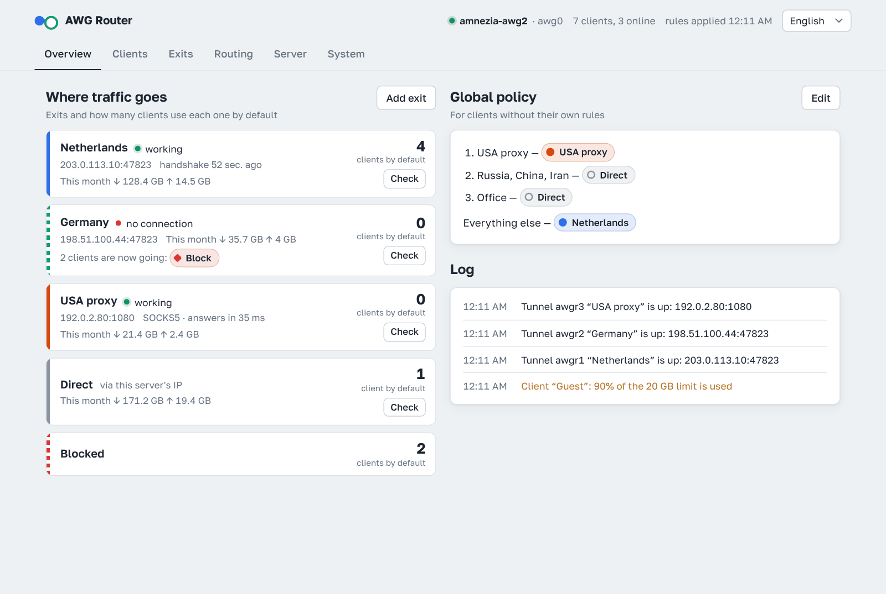
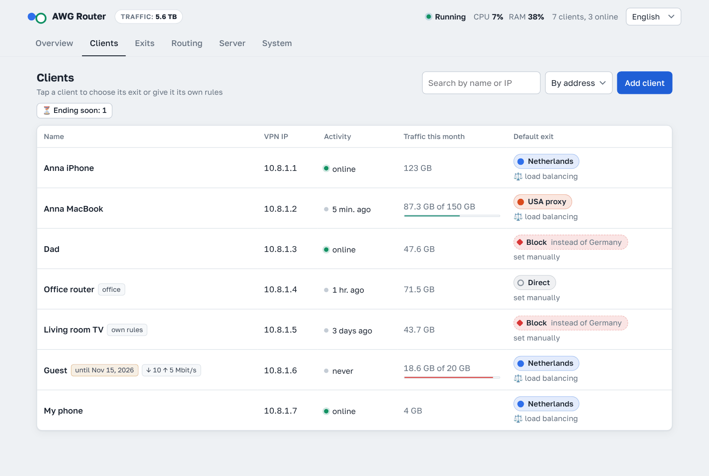
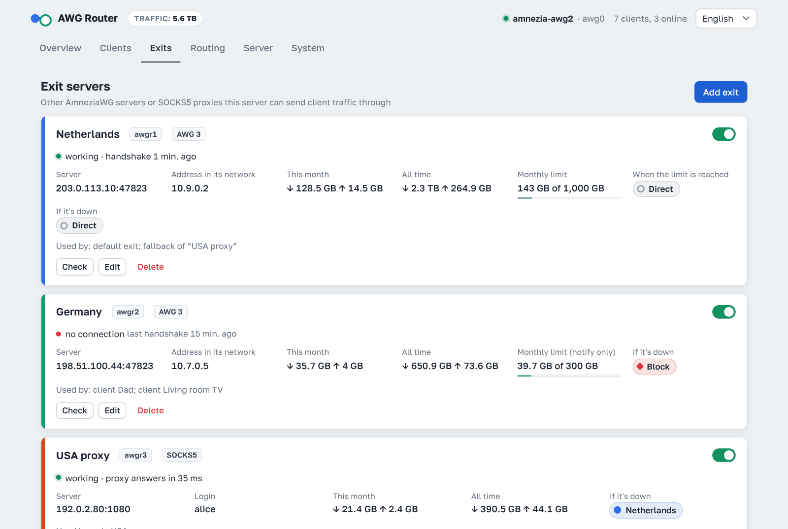
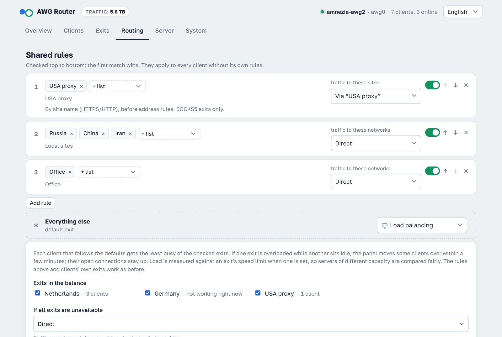
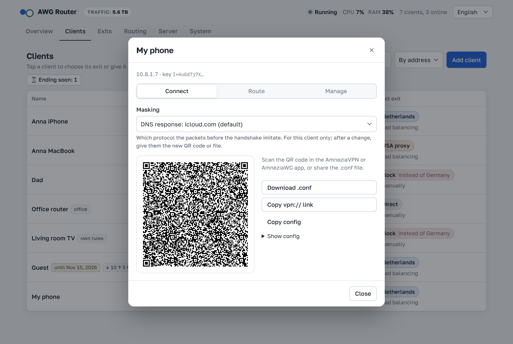
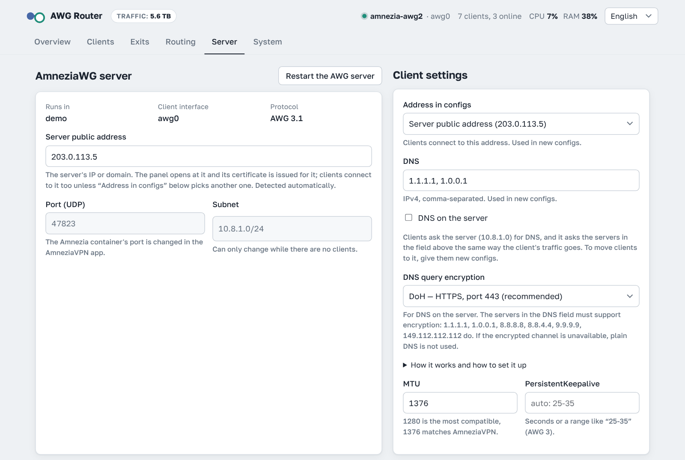
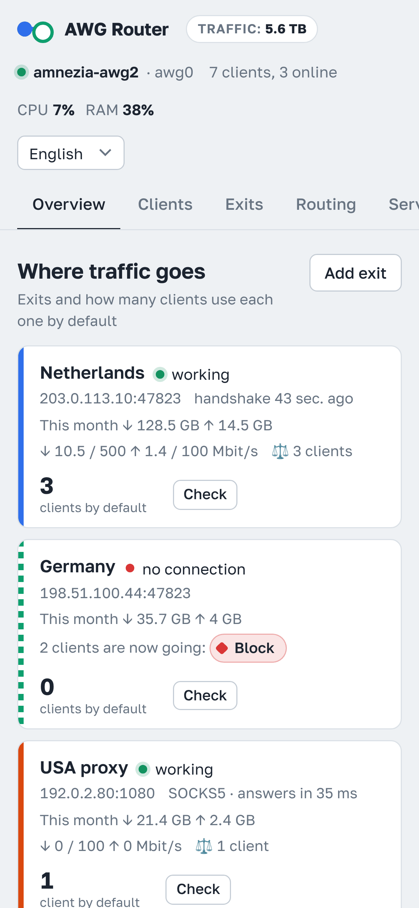

<p align="center">
  <a href="README.md">English</a> · <b>Русский</b> · <a href="README.zh.md">中文</a> · <a href="README.fa.md">فارسی</a>
</p>

<p align="center">
  <a href="https://github.com/r-slashslash/AWG-Router/releases/latest"></a>
  <a href="https://github.com/r-slashslash/AWG-Router/actions/workflows/net-tests.yml"></a>
  <a href="https://github.com/r-slashslash/AWG-Router/blob/main/LICENSE"></a>
  <a href="https://github.com/r-slashslash/AWG-Router/releases"></a>
</p>

# AWG Router

Веб-панель для **AmneziaWG**: клиенты, настройки туннеля, каскадная маршрутизация и индивидуальная маршрутизация для каждого клиента.

Работает с сервером, установленным приложением AmneziaVPN (контейнер `amnezia-awg2`), или ставит свой сервер AmneziaWG — в Docker-контейнер или прямо на хост. Поддерживается протокол AmneziaWG до версии **3.1**.

**Быстрый старт** — на сервере с Ubuntu или Debian, от root (если Docker нет, установщик поставит его сам):

```bash
curl -fsSL https://raw.githubusercontent.com/r-slashslash/AWG-Router/main/install.sh | bash
```

Установщик настроит всё сам, включая Docker Compose, и в конце покажет ссылку на панель и пароль. Подробности: [Установка](#установка).

```
                               ┌── RU / CN / IR ─────────► интернет (IP этого сервера)
 клиенты ──AWG──► этот сервер ─┤
                               ├── всё остальное ──AWG──► сервер №2 ──► интернет
                               └── клиент «Папа» ──AWG──► сервер №3 ──► интернет
```

<p align="center">
  
</p>

## Каскадный VPN (двойной VPN): российский трафик напрямую, остальное через зарубежный сервер

AWG Router делает ваш сервер AmneziaWG входом каскада. Клиенты подключаются только к нему, а сервер сам решает, откуда каждое соединение выйдет в интернет:
- российские сайты и сервисы открываются напрямую с входного сервера — с российского IP и без крюка через заграницу (банки, госуслуги и сервисы, которые не пускают иностранные адреса);
- весь остальной трафик идёт через второй сервер AmneziaWG (или прокси SOCKS5) за границей и выходит в интернет с его IP;
- выходов может быть несколько: разные списки на разные серверы или отдельный выход для одного клиента;
- деление трафика (сплит-туннелинг) настроено на сервере, конфиги клиентов обычные — на телефонах и роутерах ничего настраивать не нужно;
- список российских сетей обновляется сам, а выходы, списки и правила задаются в панели вместо ручных скриптов с iptables и ipset;
- если выход упал, трафик мимо него не утечёт: он пойдёт напрямую, заблокируется или уйдёт в другой выход — как выберете.

Резерв помогает, только когда он отказывает отдельно от основного выхода. Два выхода на один и тот же сервер — это один путь, а не два: если его адрес заблокируют целиком, прокси SOCKS5 поверх этого адреса и прямой AmneziaWG до него перестанут работать одновременно.

Поэтому в резерв лучше ставить выход на другом сервере — другой адрес, другой хостер, другая автономная система. И по возможности не обращаться к конечному серверу напрямую из страны с блокировками: если к нему ходят только из-за границы, его адрес там не виден.

Подробности — в разделе [Как устроена маршрутизация](#как-устроена-маршрутизация).

## Что умеет

**Клиенты**
- Добавить, переименовать, отключить, удалить.
- Конфиг для подключения: QR-код, файл `.conf`, ссылка `vpn://` для приложения AmneziaVPN.
- Клиенты, созданные в приложении AmneziaVPN, видны и управляются так же. Их конфиг панель показать не может: закрытый ключ есть только на устройстве.
- Отключённый клиент остаётся в конфиге закомментированным, поэтому его адрес никто не займёт.
- Трафик каждого клиента за месяц и за всё время, не сбрасывается при перезапусках. Сортировка по имени, адресу, трафику и активности.
- Общий трафик сервера за всё время — рядом с названием панели (не уменьшается при удалении клиентов).
- Срок действия и лимит трафика (в месяц или всего). Когда они заканчиваются, клиент отключается сам; месячный лимит обнуляется 1-го числа в 00:00 UTC (панель показывает, когда это по вашему времени), и клиент включается снова. За 3 дня до конца срока и при 90% лимита приходит предупреждение, а фильтр **«Скоро закончатся»** в списке клиентов показывает, у кого срок или лимит на исходе.
- Ограничение скорости (выключено, пока не задано): общий предел для всех клиентов, личный предел клиента и предел выхода, загрузка и отдача отдельно. Внутри общего предела скорость делится поровну между теми, кто сейчас качает. Соединения не рвутся, интернет просто становится медленнее, а задержка под нагрузкой не растёт.
- Личная ссылка: человек открывает её, скачивает конфиг или сканирует QR-код и видит свой трафик и срок — без входа в панель.

<p align="center">
  
</p>

**Сервер**
- Все параметры AmneziaWG: Jc/Jmin/Jmax, S1–S4, H1–H4, I1–I5, HeaderProtectionKey, ContentPaddingAddition, тайминги AWG 3, RandomTrailers, DisableCookies.
- Готовая маскировка для сигнатурных пакетов I1–I5: STUN (звонки, WebRTC), QUIC (HTTP/3), DNS-запрос, SIP и DNS-ответ про icloud.com с настоящим адресом Apple — со случайными частями, чтобы рукопожатия не были одинаковыми. Пакет, который по умолчанию ставит AmneziaVPN (одинаковый у всех, и icloud.com в нём указывает на адрес Яндекса), панель сама заменяет на этот. I1–I5 проверяются строго (только теги, которые понимает любой AmneziaWG, показан размер пакета) и задаются для отдельного клиента: если у него провайдер начал блокировать, выдайте только ему другую маскировку.
- Генерация новых параметров, как в установщике AmneziaVPN для AWG 3.1.
- Порт, подсеть, DNS/MTU/keepalive клиентов, внешний адрес и адрес в конфигах клиентов (IPv4 или IPv6).
- **DNS на сервере** (по желанию): клиенты спрашивают DNS у сервера, а он — серверы из настроек тем же путём, что и трафик клиента, с кэшем и шифрованием (DoH или DoT). Подробнее — в разделе [DNS на сервере](#dns-на-сервере).
- Добавление и удаление клиентов применяется на лету, остальные не отключаются. Серверные параметры применяются перезапуском интерфейса, это занимает несколько секунд.

**Маршрутизация**
- Выходы — это конфиги клиентов других серверов AmneziaWG или прокси SOCKS5 (`socks5://логин:пароль@адрес:порт`). Через SOCKS5 идёт и TCP, и UDP (если прокси умеет UDP ASSOCIATE). Если выход упал, трафик на выбор идёт напрямую, блокируется или уходит в другой выход.
- Трафик по каждому выходу и напрямую за месяц и за всё время, а у каждого клиента — разбивка трафика за месяц по выходам. У выхода может быть месячный лимит; когда он исчерпан, его трафик до 1-го числа идёт напрямую, блокируется или уходит на другой выход — как выберете (или приходит только уведомление).
- Правила «список → выход». Списки бывают по странам, по автономным системам (ASN), по ссылке, из своих подсетей и из доменов и обновляются сами. Правила и списки — на одной вкладке **«Маршрутизация»**: у каждого списка видно, где он используется, а новый список можно создать прямо из правила.
- Правила по доменам для выходов SOCKS5: `example.com` в списке — это и все его поддомены; можно вставить ссылку на готовый список (простой список доменов, dnsmasq, hosts, Adblock, v2ray). Сервер узнаёт сайт по имени в начале HTTPS- и HTTP-соединения (порты 443 и 80) и передаёт имя прокси — адрес находит сам прокси, поэтому подмена DNS у провайдера не мешает. DNS и конфиги клиентов не меняются. Такие правила проверяются раньше правил по адресам.
- В окне выхода сначала выбирается тип (AmneziaWG или SOCKS5). Для SOCKS5 есть отдельные поля адреса, порта, логина и пароля (из них собирается строка подключения, а вставленная строка сама раскладывается по полям), и маршрутизация через этот выход настраивается в том же окне: сайты (домены), списки доменов и сетей или весь трафик. Сохраняется как обычные общие правила; выключенные правила, их подписи и порядок не меняются.
- У каждого клиента может быть свой выход и свои правила.
- **Балансировка** (по желанию) вместо выхода по умолчанию: каждый клиент получает самый свободный из выбранных выходов; загрузка считается от ограничения скорости выхода, если оно задано. Если один выход перегружен, а другой простаивает, часть клиентов через несколько минут переходит на другой, не теряя открытых соединений; клиенты упавшего выхода переходят сразу. Правила и личные выходы клиентов работают как раньше.
- «Проверка маршрута» показывает, куда пойдёт трафик до нужного IP или домена.

<p align="center">
  
  
</p>

**Панель**
- HTTPS с сертификатом Let's Encrypt на IP-адрес или ваш домен, который продлевается сам, или со своим сертификатом (например, от certbot). Если порт 80 уже занят nginx или Apache, проверка идёт через них.
- Можно вместо этого входить только через SSH-туннель.
- В адресе случайный порт и секретный путь, вход по паролю, есть защита от подбора. Вход действует 4 часа.
- По желанию — второй фактор: 6-значный код из приложения-аутентификатора (Google Authenticator, Aegis, 2FAS…). Включается на вкладке **«Система»**.
- По желанию — уведомления в Telegram: выход перестал или снова начал работать или подходит к лимиту, сервер AmneziaWG недоступен или перезапустился, у клиента скоро закончится или закончился срок или лимит, новый клиент подключился впервые, вход в панель, не продлевается сертификат, вышла новая версия. Настраиваются на вкладке **«Система»**. Там, где Telegram заблокирован (Россия, Китай, Иран), бот может отправлять сообщения через один из ваших выходов; если этот выход перестал работать, сообщение пробует остальные выходы, затем уходит напрямую, а если не работает ничего — ждёт появления связи.
- По желанию — управление из Telegram: бот становится пультом: `/start` открывает меню в одном сообщении — логотип панели, а под ним хост, версия панели, клиенты, сколько из них в сети и общий трафик, — и всё управление идёт в нём же, с кнопкой «‹ Меню» для возврата. В **«Сервере»** — состояние (версии, IPv4 и IPv6, DNS на сервере, время работы, RAM, трафик за месяц) и выходы (нажатый выход можно проверить или сделать основным); **«Клиенты»** начинаются с кнопки **«Новый клиент»**. А ещё: включить, выключить или удалить клиента (с подтверждением), его QR-код и файл конфига, +30 дней или +10 ГБ, новый клиент командой `/add`, проверка выхода и смена основного, куда пойдёт трафик до адреса, резервная копия, ссылка на панель и обновление панели. Кнопки появляются и под уведомлениями (например, «+30 дней» под «истёк срок»). Бот слушается только чат, указанный в панели.
- Пароль можно сменить прямо в панели.
- Резервная копия и восстановление одним файлом: настройки панели, выходы, правила, ключи клиентов и конфиг сервера AmneziaWG — удобно для переезда на другой сервер. При скачивании файл можно зашифровать паролем. Бот может присылать копию в Telegram каждый день или раз в неделю, зашифрованную паролем, если он задан.
- Панель показывает свою версию, сообщает о выходе обновления и обновляется одной кнопкой (или командой `awg-router update` на сервере). Ставится только опубликованная версия, а её архив сверяется с контрольной суммой.
- Панель можно установить на телефон: «Система» → «Установить на телефон» покажет QR-код и как добавить её на главный экран, откуда она откроется как приложение.
- Языки: русский, английский, китайский, фарси. Язык выбирается по языку браузера или системы, выбранный вручную запоминается.

<p align="center">
  
  
</p>

<p align="center">
  
</p>

## Установка

Нужен сервер на **Ubuntu или Debian**. Команду выполняйте от root (если входите под другим пользователем, сначала выполните `sudo -i`). Docker установщик поставит сам, если его нет.

```bash
curl -fsSL https://raw.githubusercontent.com/r-slashslash/AWG-Router/main/install.sh | bash
```

Установщик скачает панель в `/opt/awg-router`. Он говорит по-английски и задаст несколько вопросов:

1. **Чем управлять.**
   - Если найден контейнер AmneziaVPN, предложит управлять им или отдельным сервером AmneziaWG на хосте.
   - Если AmneziaWG на сервере нет, предложит установить. Можно в Docker-контейнер, как это делает AmneziaVPN, и тогда приложение тоже увидит сервер. Или прямо на хост, службой systemd. UDP-порт предложит случайный.
2. **Как заходить в панель:** через браузер по HTTPS или только через SSH-туннель.
3. **Домен панели** (только для браузера). Enter — панель открывается по IP; домен должен указывать на этот сервер.

Если порт 80 уже занят nginx или Apache, установщик покажет маленький файл, который может добавить туда для проверки Let's Encrypt, и спросит, прежде чем добавлять (см. [Порт 80 занят веб-сервером](#порт-80-занят-веб-сервером)).

Он спросит порт панели (Enter — случайный свободный 4-значный); остальное сделает сам: сгенерирует пароль, поставит образ панели и получит сертификат. Образ скачивается готовым из реестра GitHub (ghcr.io), поэтому серверу не нужно обращаться к источникам Alpine и GitHub, которые в некоторых странах фильтруются; если скачать не удалось, образ собирается на сервере, как раньше (`AWGR_BUILD=1` — всегда собирать). В конце покажет ссылку и пароль:

```
  AWG Router is ready
  Link:     https://203.0.113.5:4721/3f9a1c2e7b6d/
  Password: Xk3vQ9mT2pLw8ZrA
  Let's Encrypt certificate valid until 2026-11-04 08:15, renews automatically
```

> **Фаервол:** откройте TCP-порт **80** (он нужен на несколько секунд, пока Let's Encrypt проверяет сервер) и порт панели. Если у хостинга есть свой фаервол в личном кабинете, откройте порты и там.

### Команда `awg-router`

| Команда | Что делает |
|---|---|
| `awg-router info` | показать ссылку и пароль |
| `awg-router update` | скачать новую версию и обновиться (настройки сохраняются) |
| `awg-router password` | сменить пароль на новый случайный |
| `awg-router 2fa-off` | выключить вход по коду из приложения (если потеряли телефон) |
| `awg-router restart` | перезапустить панель |
| `awg-router logs` | журнал панели |
| `awg-router reconfigure` | заново выбрать режим и способ входа |
| `awg-router uninstall` | удалить панель и её правила маршрутизации; сервер AmneziaWG и клиенты остаются |

### Вход через SSH-туннель

В этом режиме панель не видна из интернета. На телефоне (Termux) или компьютере выполните:

```bash
ssh -N -L ПОРТ:127.0.0.1:ПОРТ root@IP-СЕРВЕРА
```

Не закрывая это окно, откройте в браузере `http://127.0.0.1:ПОРТ/секретный-путь/`. Точную команду и адрес покажет `awg-router info`.

## Сертификат

- Панель получает сертификат Let's Encrypt через [lego](https://go-acme.github.io/lego/) на IP сервера или домен панели, с проверкой по порту 80, и продлевает его без перезапуска. На IP-адрес Let's Encrypt выдаёт сертификаты только на 6 дней (профиль `shortlived`), поэтому панель продлевает его примерно раз в 3 дня.
- **«Система» → «Домен и сертификат»**: домен панели (пусто — по IP) и выбор между Let's Encrypt и своим сертификатом. Для своего укажите пути на сервере к сертификату (с цепочкой) и ключу, например от certbot: `/etc/letsencrypt/live/example.com/fullchain.pem` и `privkey.pem`. Панель проверит, что сертификат выдан на адрес панели и ключ к нему подходит; когда certbot продлит сертификат, панель подхватит новый за несколько минут.
- Домен — только адрес панели: в конфигах клиентов остаётся адрес сервера с вкладки **«Сервер»**.
- Если получить сертификат не удалось, панель работает с временным самоподписанным, и браузер покажет предупреждение. Попытки повторяются каждые 30 минут.
- Статус и кнопка **«Получить сертификат сейчас»** — на вкладке **«Система»**.

### Порт 80 занят веб-сервером

Если на сервере уже работают сайты на nginx или Apache, Let's Encrypt проверяет панель через них. Установщик и **«Система» → «Настроить проверку через веб-сервер»** сначала показывают файл и добавляют его, только если вы согласны:
- nginx (а также Angie и OpenResty) на хосте или в Docker, если папка его конфигов подключена с хоста: `awg-router-acme.conf` рядом с вашими конфигами (`conf.d`, `sites-enabled`). Apache на хосте: сайт `awg-router-acme.conf`.
- Файл отвечает только на `/.well-known/acme-challenge/` и только для адреса панели, из папки `/var/lib/awg-router/acme`. Ваши сайты и другие файлы настроек не меняются.
- Перед перезагрузкой конфиг проверяется (`nginx -t`, `apachectl configtest`), потом панель запрашивает через веб-сервер проверочный файл. При любой ошибке файл удаляется, и веб-сервер возвращается к прежним настройкам.
- Caddy, другие веб-серверы и контейнеры, у которых конфиг внутри образа: панель показывает блок, который нужно вставить вручную, а потом нажать **«Проверить»**.
- **«Убрать из веб-сервера»** и `awg-router uninstall` удаляют файл.

## Режимы сервера

### Контейнер AmneziaVPN

Панель пишет конфиг в формате приложения:
- общий PSK;
- `clientsTable` с именами клиентов;
- I1–I5 в комментариях.

Клиенты, добавленные в панели, видны в приложении, и наоборот.

Ограничения этого режима:
- Порт контейнера меняется только в приложении AmneziaVPN.
- В контейнере, созданном приложением AmneziaVPN, нельзя поменять и подсеть: приложение вписывает её в скрипт запуска контейнера.
- Если в панели изменить серверные параметры (S1–S4, H1–H4, ключ защиты заголовков), приложение об этом не узнает. Новые клиенты из приложения не подключатся, пока вы не выполните в приложении повторную проверку сервера: оно перечитает параметры с сервера.

Если контейнер ставил установщик AWG Router, конфиги лежат на хосте в `/opt/awg-router/awg-server/data` и переживают пересоздание контейнера.

### AmneziaWG на хосте

Панель ставит на хост `awg`, `awg-quick`, `amneziawg-go` (AWG 3.1) и службу `awg-quick@awg0`.
- Конфиг: `/etc/amnezia/amneziawg/awg0.conf`.
- NAT и правила пересылки добавляются через `PostUp`, поэтому VPN работает, даже когда панель остановлена. При смене подсети панель переносит NAT на новую.

## DNS на сервере

Включается на вкладке **«Сервер» → «Настройки клиентов» → «DNS на сервере»**, по умолчанию выключено. Похоже на AmneziaDNS из приложения AmneziaVPN, но устроено с учётом каскада.

**Как работает.** Панель запускает в сети сервера AWG небольшой DNS-сервер (`dnsproxy.py`, порт 53 на адресе сервера в туннеле, например `10.8.1.1`). Клиенты получают его адрес в строке `DNS` конфига, вторым — первый сервер из поля «DNS». Сервер не ищет имена сам, а пересылает запрос серверам из поля «DNS» — **через основной выход этого клиента** (если выход не работает — через его резервный путь, как и трафик). Ответы кэшируются на время их TTL отдельно для каждого выхода, поэтому повторный запрос не идёт через каскад.

**Шифрование.** Запросы к серверам из поля «DNS» шифруются — настройка **«Шифрование запросов DNS»**:
- **DoH** (по умолчанию) — DNS поверх HTTPS, порт 443. Выглядит как обычный HTTPS, его труднее всего заблокировать;
- **DoT** — DNS поверх TLS, порт 853;
- **без шифрования** — обычный DNS.

С шифрованием ни провайдер входного сервера, ни провайдер выхода не видят, какие сайты открывают клиенты, и не могут подменить ответ: сертификат сервера проверяется. TLS-соединения держатся открытыми, поэтому рукопожатие не повторяется на каждый запрос. Серверы из поля «DNS» должны поддерживать шифрование: подходят `1.1.1.1`, `1.0.0.1` (Cloudflare), `8.8.8.8`, `8.8.4.4` (Google), `9.9.9.9`, `149.112.112.112` (Quad9). Если зашифрованный канал недоступен, открытый DNS вместо него не используется: клиент спросит второй DNS из конфига, а панель покажет «Серверы DNS не отвечают».

**Подвох каскада.** Резолвер на входном сервере, который спрашивает интернет прямо оттуда (так работает AmneziaDNS), получает ответы «глазами» страны входа. CDN по адресу резолвера решают, где клиент, и выдают узлы рядом с входным сервером, хотя трафик уходит через выход в другой стране: сайты и видео открываются медленно, а сервисы с проверкой региона могут отказать. AmneziaDNS шифрует запросы, поэтому провайдер не подменит ответы, но может заблокировать само зашифрованное соединение.

Здесь запрос идёт тем же путём, что и трафик клиента, поэтому у клиентов, которые выходят через другой сервер, ответы правильные для их страны. У клиентов, у которых основной путь — «напрямую», запросы уходят прямо с входного сервера, как у AmneziaDNS. Для них это правильно: их трафик уходит оттуда же, а шифрование защищает запросы от провайдера.

Ограничения:
- клиент с блоком получает отказ;
- правила по адресам (например, «российские сети напрямую») на DNS не влияют: имена таких сайтов тоже разрешаются через основной выход клиента, и CDN может выдать для них зарубежный узел;
- сервер только пересылает запросы и не проверяет подписи DNSSEC сам — это делают серверы из поля «DNS»;
- пока панель остановлена или обновляется, клиенты спрашивают второй DNS из конфига.

**Как лучше пользоваться.**
1. Оставьте шифрование **DoH**, а в поле «DNS» — серверы, которые его поддерживают, например `1.1.1.1, 8.8.8.8`. Серверы местного провайдера не подходят: запросы к ним всё равно пойдут через выход, а шифрование они обычно не умеют.
2. Включайте, если у большинства клиентов основной путь — через выход.
3. После включения или выключения отдайте клиентам новые конфиги (QR-коды или файлы): старые продолжают спрашивать прежние DNS.
4. Отдельный AmneziaDNS при этом не нужен; если он установлен, панель его не трогает.

## Как устроена маршрутизация

Панель работает в отдельном контейнере (`network_mode: host`, `pid: host`, `privileged`) и через `nsenter` входит в сеть сервера AWG.
- Для каждого выхода поднимается туннель `awgrN` с отдельной таблицей маршрутизации. У выхода SOCKS5 это интерфейс [hev-socks5-tunnel](https://github.com/heiher/hev-socks5-tunnel): всё, что в него попало, уходит через прокси.
- Правила по доменам: TCP 80/443 клиентов, у которых они есть, перенаправляется в обработчик в сети сервера (`sniproxy.py`). Он читает имя сайта (SNI или Host); совпало — соединение через прокси SOCKS5 по имени, нет — к исходному адресу с меткой политики клиента, и обычные правила по адресам выбирают путь (цепочка nftables `type route` в hook output). Данные пересылаются внутри ядра (`splice`), без копирования через Python. QUIC (UDP 443) у таких клиентов блокируется, браузеры сами переходят на HTTPS. Если обработчик не работает, панель убирает перенаправление, и действуют только правила по адресам.
- Пакеты клиентов помечаются правилами nftables в таблице `ip awgr`.
- Адрес туннеля на выходном сервере подставляется через SNAT и не конфликтует с вашими клиентами.
- Если туннель пропал, в его таблице остаётся маршрут `unreachable`, и трафик не утечёт мимо выхода.
- Балансировка закрепляет клиента за выходом, а каждое соединение запоминает свой выход в conntrack (`ct mark`), поэтому при переносе клиента через новый выход идут только его новые соединения. Ограничение скорости — очереди `tc` HTB: на интерфейсе клиентов (`awg0`) для клиентов и на `awgrN` для выходов; входящий трафик ограничивается через устройство `ifb`.

Всё, что применено, видно на вкладке **«Система»** в разделе **«Что применено сейчас»**.

## Безопасность

Панель — это фактически root-доступ к серверу.
- Пароль длинный и случайный, а в адресе есть случайный порт и секретный путь.
- После 8 неверных паролей вход с этого IP блокируется на 10 минут.
- Самый закрытый вариант — вход только через SSH-туннель.
- Закрытые ключи выходов и клиентов, созданных в панели, лежат в `/opt/awg-router/data/state.json` с правами 600.
- Управление из Telegram слушается чата, а не человека: если это группа, панелью может управлять любой её участник. Используйте личный чат с ботом.
- В резервной копии лежат закрытые ключи сервера и всех клиентов. Задайте пароль для скачиваемых копий и для копий в Telegram.
- Начиная с 1.19.1 образы и архив собирает GitHub Actions, у них есть подписанная аттестация сборки, а у образов ещё и SBOM (список компонентов). Скачанное можно проверить командами `gh attestation verify oci://ghcr.io/r-slashslash/awg-router:<version> -R r-slashslash/AWG-Router` (образы) и `gh attestation verify awg-router.tar.gz -R r-slashslash/AWG-Router` (архив).

## Ограничения

- В туннеле только IPv4. Подключение к серверу — по IPv4 или IPv6.
- Правила по доменам видят только HTTPS и HTTP (порты 443 и 80) и не видят сайт, если браузер прячет имя (Encrypted Client Hello): тогда соединение идёт по правилам адресов. В режиме «AWG на хосте» с файрволом только на nftables (например, firewalld) разрешите вход на TCP-порт 10443 с интерфейса клиентов; для iptables и ufw панель делает это сама.
- Выходам SOCKS5 нужна поддержка IPv6 в ядре (она есть всегда, кроме серверов, загруженных с `ipv6.disable=1`).
- Списки стран построены по регистрационным данным. Для конкретных сервисов точнее списки по ASN.
- Для ограничения отдачи клиентов и загрузки через выходы нужен модуль ядра `ifb`. Установщик ставит его сам (на облачных ядрах — пакет `linux-modules-extra`); если для ядра такого пакета нет, панель об этом пишет, остальные ограничения работают.

## Разработка

```bash
python3 -m unittest discover tests                                     # конфиги, nftables, параметры
sudo PYTHONPATH=<pyroute2>:. python3 tests/netns_e2e.py                 # маршрутизация в сетевых пространствах
sudo PATH=<awg,amneziawg-go>:$PATH PYTHONPATH=<pyroute2>:. python3 tests/awg_real_e2e.py
                                                                        # настоящий туннель AWG клиент ↔ сервер
sudo PATH=<hev-socks5-tunnel>:$PATH PYTHONPATH=<pyroute2>:. python3 tests/domains_socks_e2e.py
                                                                        # выход SOCKS5 и правила по доменам
DRY_RUN=1 PANEL_PASSWORD=demo DATA_DIR=./demo python3 -m app.main       # демо без сервера
```

Самой панели хватает стандартной библиотеки Python. В Docker-образ дополнительно входят `amneziawg-go`, `amneziawg-tools`, `hev-socks5-tunnel` и `lego`.

## Благодарности

### Люди, которые помогли

Они находили проблемы, разбирали их до строки и предлагали решения; многое в этой панели появилось благодаря им.

<table>
<tr>
<td align="center" valign="top" width="33%"><a href="https://github.com/Neborya"><br><b>Neborya</b></a><br>🐛 💡<br><sub>пакет Compose в Debian 13 <a href="https://github.com/r-slashslash/AWG-Router/issues/1">#1</a>, трафик по выходам <a href="https://github.com/r-slashslash/AWG-Router/issues/2">#2</a>, Telegram через выход <a href="https://github.com/r-slashslash/AWG-Router/issues/3">#3</a>, порт 80 вместе с веб-сервером <a href="https://github.com/r-slashslash/AWG-Router/issues/4">#4</a>, имена клиентов в конфигах <a href="https://github.com/r-slashslash/AWG-Router/issues/7">#7</a></sub></td>
<td align="center" valign="top" width="33%"><a href="https://github.com/koo-pub"><br><b>koo-pub</b></a><br>💻<br><sub>QR-коды, которые надёжно читаются в AmneziaWG на Android <a href="https://github.com/r-slashslash/AWG-Router/issues/5">#5</a></sub></td>
<td align="center" valign="top" width="33%"><a href="https://github.com/LCF30"><br><b>LCF30</b></a><br>🐛 💻 🔍<br><sub>выходы с доменным именем в Endpoint <a href="https://github.com/r-slashslash/AWG-Router/issues/6">#6</a>, готовые образы для России, Китая и Ирана <a href="https://github.com/r-slashslash/AWG-Router/issues/8">#8</a>, проверка выходов SOCKS5 <a href="https://github.com/r-slashslash/AWG-Router/issues/9">#9</a>, уведомления Telegram, не зависящие от упавшего выхода <a href="https://github.com/r-slashslash/AWG-Router/issues/10">#10</a>, скачивание релиза через API GitHub, когда github.com не отдаёт файл <a href="https://github.com/r-slashslash/AWG-Router/pull/13">#13</a></sub></td>
</tr>
<tr>
<td align="center" valign="top" width="33%"><a href="https://github.com/alexeyvolodin"><br><b>alexeyvolodin</b></a><br>💻 🔍<br><sub>правила по доменам с пересылкой внутри ядра <a href="https://github.com/r-slashslash/AWG-Router/pull/19">#19</a>, проверка занятого порта в установщике <a href="https://github.com/r-slashslash/AWG-Router/pull/17">#17</a></sub></td>
</tr>
</table>

🐛 находили и разбирали проблемы · 💡 идеи · 💻 код · 🔍 проверка на настоящих серверах

### Проекты

- [AmneziaWG](https://github.com/amnezia-vpn) — протокол, `amneziawg-go` и `amneziawg-tools`
- [lego](https://github.com/go-acme/lego) — клиент Let's Encrypt
- [hev-socks5-tunnel](https://github.com/heiher/hev-socks5-tunnel) — выходы SOCKS5 (MIT)
- [ipverse](https://github.com/ipverse) — списки IP по странам и ASN
- [QR Code Generator](https://github.com/kazuhikoarase/qrcode-generator), автор Kazuhiko Arase (MIT)
- Шрифты [Golos Text](https://github.com/googlefonts/golos-text), [JetBrains Mono](https://github.com/JetBrains/JetBrainsMono), [Vazirmatn](https://github.com/rastikerdar/vazirmatn) (SIL Open Font License 1.1)

## Лицензия

[MIT](LICENSE)
