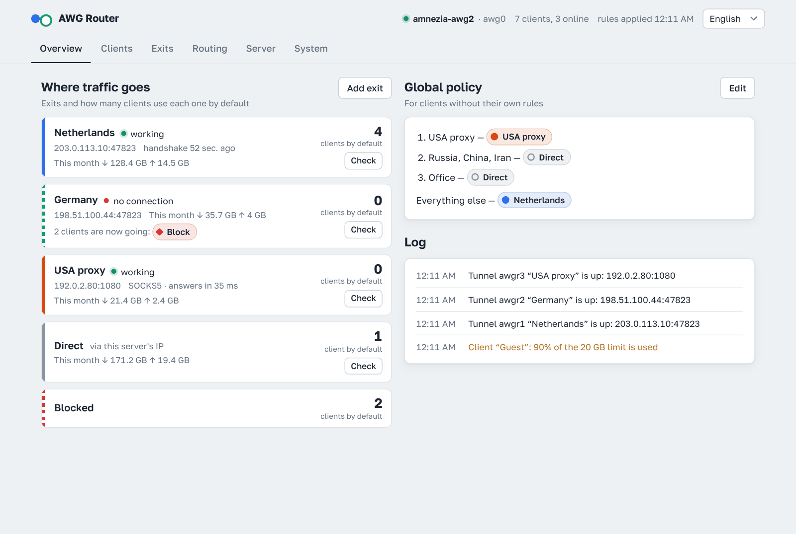
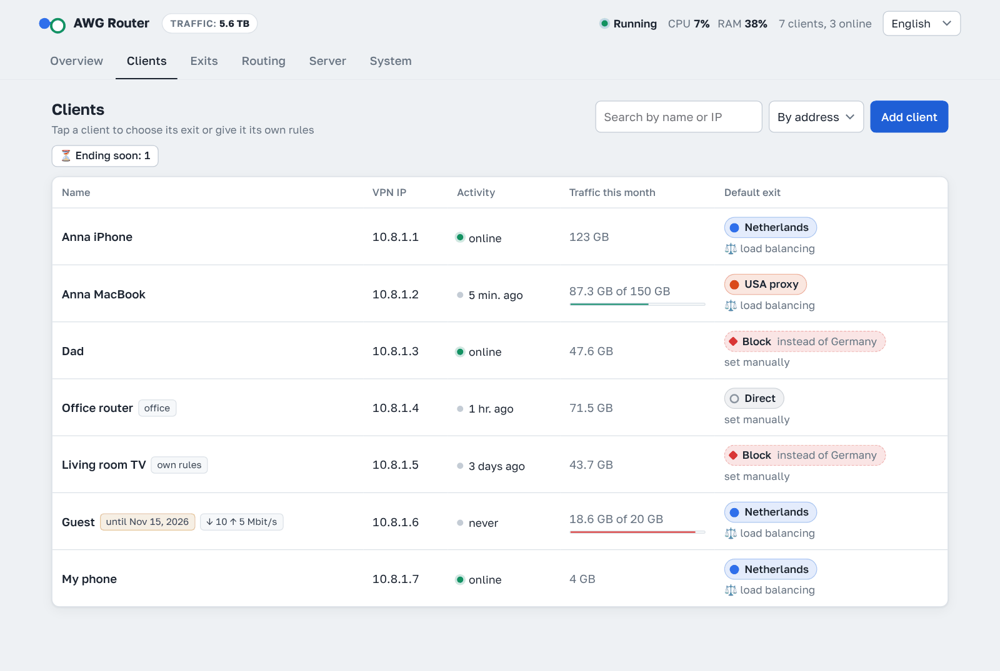
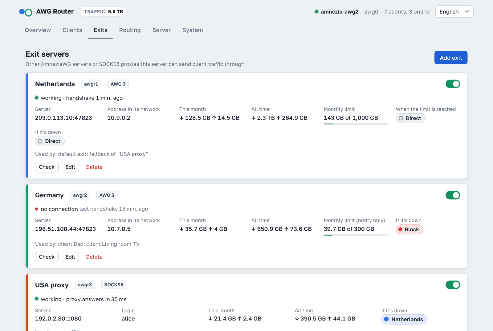
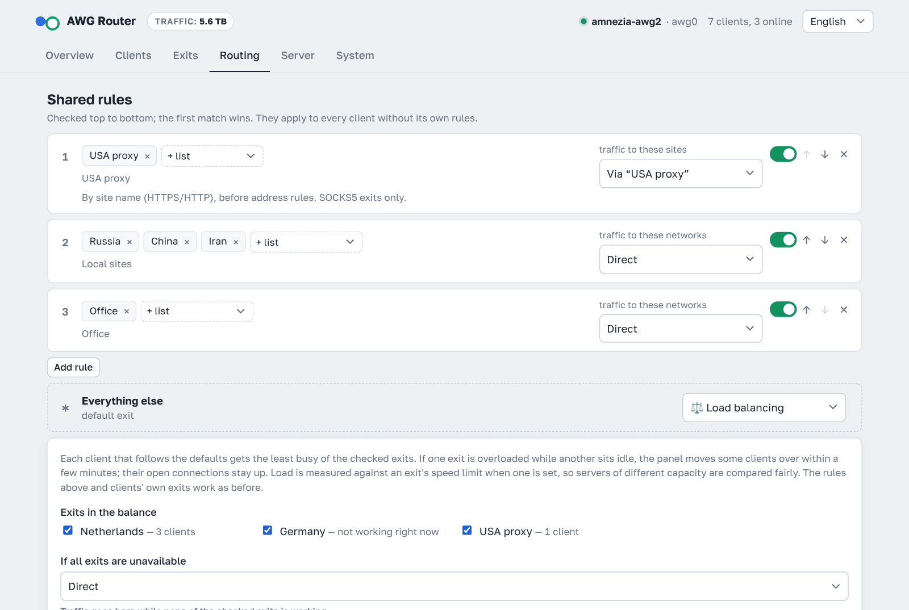
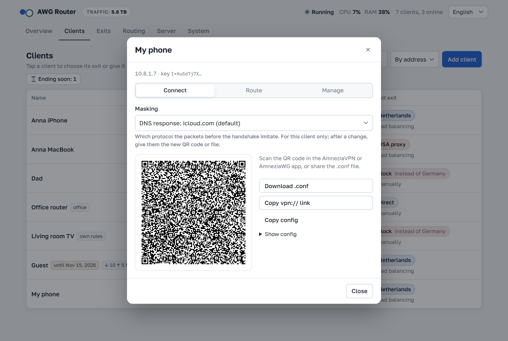
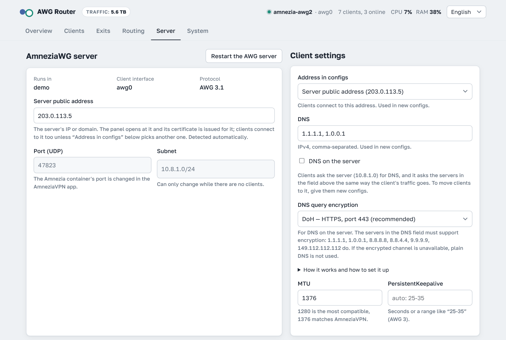
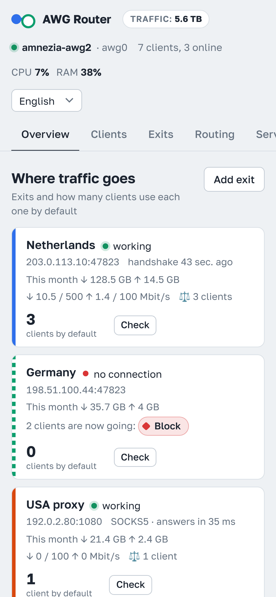

<p align="center">
  <a href="README.md">English</a> · <a href="README.ru.md">Русский</a> · <b>中文</b> · <a href="README.fa.md">فارسی</a>
</p>

# AWG Router

**AmneziaWG** 的 Web 管理面板：用户、隧道设置、级联路由以及为每个客户端单独设置的路由，集中在一个地方管理。

它可以管理 AmneziaVPN 应用安装的服务器（Docker 容器 `amnezia-awg2`），也可以安装自己的 AmneziaWG 服务器——在 Docker 容器中或直接在主机上。协议最高支持 **AmneziaWG 3.1**。

```
客户端 ──AWG──► 本服务器
  ├── RU / CN / IR ─────────► 互联网（本服务器 IP）
  ├── 其他所有流量 ──AWG──► 服务器 #2 ──► 互联网
  └── 客户端「爸爸」──AWG──► 服务器 #3 ──► 互联网
```

<p align="center">
  
</p>

## 级联 VPN（双重 VPN / 中转）：国内流量直连，国外流量走境外服务器

AWG Router 让你的 AmneziaWG 服务器成为级联的入口（中转服务器）。客户端只连接它，由服务器决定每个连接从哪里出到互联网：
- 访问中国大陆的网站和服务直接从入口服务器出去，使用国内 IP，不绕路境外；
- 其他所有流量经第二台境外 AmneziaWG 服务器（或 SOCKS5 代理）转发，以它的 IP 访问互联网；
- 出口可以有多个：不同列表走不同服务器，或者给单个客户端单独的出口；
- 分流在服务器上完成，客户端配置保持普通——手机和路由器上无需任何设置；
- 中国 IP 列表自动更新，出口、列表和规则都在面板中配置，不用手写 iptables 和 ipset 脚本；
- 出口断开时流量不会绕过它泄露：按你的选择改为直连、阻断或切换到另一个出口。

详见 [路由原理](#路由原理)。

## 功能

**客户端**
- 添加、重命名、停用和删除客户端。
- 通过二维码、`.conf` 文件或 AmneziaVPN 应用的 `vpn://` 链接连接设备。
- 在 AmneziaVPN 应用中创建的客户端同样会显示并可管理。面板无法显示它们的配置，因为私钥只保存在设备上。
- 停用的客户端以注释形式保留在配置中，其地址不会被他人占用。
- 每个客户端的本月和累计流量，重启后不会清零。可按名称、地址、流量或活动排序。
- 面板名称旁显示服务器的累计总流量（删除客户端后不会减少）。
- 有效期和流量限额（每月或总计）。到期或用完时客户端会自动停用；每月限额在 1 日 00:00 UTC 清零（面板会显示对应的您当地时间），客户端会重新启用。到期前 3 天和用量达到 90% 时会发出提醒，客户端列表中的 **即将到期** 筛选可显示哪些客户端快到期。
- 个人链接：对方打开链接即可下载配置或扫描二维码，并查看自己的流量和有效期，无需登录面板。

<p align="center">
  
</p>

**服务器**
- 全部 AmneziaWG 参数：Jc/Jmin/Jmax、S1–S4、H1–H4、I1–I5、HeaderProtectionKey、ContentPaddingAddition、AWG 3 计时参数、RandomTrailers 和 DisableCookies。
- 为签名数据包 I1–I5 提供现成的伪装：STUN（通话、WebRTC）、QUIC（HTTP/3）、DNS 查询、SIP 以及带有 Apple 真实地址的 icloud.com DNS 响应，并带随机部分，使每次握手都不相同。AmneziaVPN 默认使用的数据包（所有地方都相同，且其中 icloud.com 指向 Yandex 的地址）会被面板自动替换为这个。I1–I5 会被严格检查（只允许所有 AmneziaWG 都支持的标签，并显示数据包大小），还可按客户端单独设置：如果某个客户端的运营商开始封锁，只给它换一种伪装即可。
- 一键生成新参数，生成方式与 AmneziaVPN 安装程序为 AWG 3.1 所用的相同。
- 端口、子网、客户端 DNS/MTU/keepalive、公网地址以及客户端配置中的地址（IPv4 或 IPv6）。
- **服务器上的 DNS**（可选）：客户端向服务器查询 DNS，服务器再经由与该客户端流量相同的路径查询设置中的服务器，并带缓存和加密（DoH 或 DoT）。详见 [服务器上的 DNS](#服务器上的-dns)。
- 添加或删除客户端即时生效，不会断开其他人。服务器端参数通过重启接口生效，只需几秒钟。

**路由**
- 出口是来自其他 AmneziaWG 服务器的客户端配置或 SOCKS5 代理（`socks5://用户名:密码@地址:端口`）。TCP 和 UDP 都会经过 SOCKS5 出口（UDP 需要代理支持 UDP ASSOCIATE）。出口故障时，其流量可按你的选择改为直连、阻断或切换到另一个出口。
- 每个出口和直连的本月及累计流量，以及每个客户端本月按出口划分的流量。出口可设置每月限额：用完后，到下月 1 日前其流量改为直连、被阻止或切换到另一个出口，由你选择（或仅发送通知）。
- 规则把列表映射到出口。列表可以是国家、自治系统（ASN）、从 URL 获取的列表、你自己的子网或域名，并会自动更新。规则和列表都在 **路由** 标签页：每个列表都显示它在哪里被使用，也可以直接在规则中新建列表。
- SOCKS5 出口的域名规则：列表中的 `example.com` 同时匹配它的所有子域名；也可以粘贴现成列表的链接（普通域名列表、dnsmasq、hosts、Adblock、v2ray）。服务器从 HTTPS 和 HTTP 连接开头的网站名称（443 和 80 端口）识别网站，并把名称交给代理，由代理自己解析地址，因此运营商的 DNS 污染不受影响。客户端的 DNS 和配置都不变。这类规则在地址规则之前检查。
- 出口窗口先选择类型（AmneziaWG 或 SOCKS5）。SOCKS5 有单独的地址、端口、用户名和密码字段（它们组成连接字符串，粘贴的字符串也会自动填入字段），经此出口的路由也在同一窗口设置：网站（域名）、域名列表和网络列表，或全部流量。保存为普通的全局规则；已关闭的规则、规则名称和顺序保持不变。
- 每个客户端都可以有自己的出口和规则。
- **路由检测** 可显示到某个 IP 或域名的流量会走哪条路。

<p align="center">
  
  
</p>

**面板**
- 使用为服务器 IP 或你的域名签发的 Let's Encrypt 证书提供 HTTPS，证书自动续期；也可以使用自有证书（例如 certbot 签发的）。如果 80 端口已被 nginx 或 Apache 占用，验证会通过它们进行。
- 也可以设置为只能通过 SSH 隧道访问面板。
- 地址包含随机端口和秘密路径，登录需要密码，并有防暴力破解保护。登录有效期为 4 小时。
- 可选的第二重验证：身份验证器应用（Google Authenticator、Aegis、2FAS…）中的 6 位代码。在 **系统** 选项卡中启用。
- 可选的 Telegram 通知：出口停止或恢复工作或接近限额、AmneziaWG 服务器不可达或重启、客户端即将或已经到期、即将或已经用完限额、新客户端首次连接、面板登录、证书无法续期、面板发布新版本。在 **系统** 选项卡中设置。在屏蔽 Telegram 的地区（俄罗斯、中国、伊朗），机器人可以经由你的某个出口发送消息；如果该出口停止工作，消息会先尝试其他出口，然后直接发出，若都不通则等待连接恢复。
- 可选的 Telegram 控制：机器人成为遥控器：`/start` 在一条消息中打开菜单——面板标志，下方是主机、面板版本、客户端数、在线数和累计流量——所有操作都在这条消息里进行，用“‹ 菜单”按钮返回。**服务器** 中有状态（版本、IPv4 和 IPv6、服务器上的 DNS、运行时间、内存、本月流量）和出口（点击出口可检查它或设为默认）；**客户端** 以 **新建客户端** 按钮开头。此外还有：启用、停用或删除客户端（需确认）、发送其二维码和配置文件、+30 天或 +10 GB、用 `/add` 新建客户端、检查出口和更换默认出口、查询访问某地址的流量走哪里、备份、面板链接和更新面板。通知下方也会出现按钮（例如“使用期限已到”下方的“+30 天”）。机器人只听从面板中设置的聊天。
- 可以直接在面板中更改密码。
- 单文件备份与恢复：面板设置、出口、规则、客户端密钥和 AmneziaWG 服务器配置——便于迁移到其他服务器。下载的文件可以用密码加密。机器人还可以每天或每周把备份发送到 Telegram，设置密码后备份会被加密。
- 面板会显示自己的版本，在有更新时提示，并可一键更新（或在服务器上运行 `awg-router update`）。只会安装已发布的版本，其归档会按校验和检查。
- 可以把面板安装到手机：**系统 → 安装到手机** 会显示二维码以及如何把面板添加到主屏幕，之后它会像应用一样打开。
- 界面语言：英语、俄语、中文和波斯语。语言跟随浏览器或系统设置，手动选择的语言会被记住。

<p align="center">
  
  
</p>

<p align="center">
  
</p>

## 安装

需要一台 **Ubuntu 或 Debian** 服务器。请以 root 身份运行（如果用其他用户登录，先执行 `sudo -i`）。如果没有 Docker，安装程序会自动安装。

```bash
curl -fsSL https://raw.githubusercontent.com/r-slashslash/AWG-Router/main/install.sh | bash
```

安装程序会把面板下载到 `/opt/awg-router`。它使用英文界面，会问几个问题：

1. **管理什么。**
   - 如果找到 AmneziaVPN 容器，会让你选择管理该容器，或主机上单独的 AmneziaWG 服务器。
   - 如果服务器上没有 AmneziaWG，会提供安装：可以像 AmneziaVPN 那样装进 Docker 容器（应用也能识别），也可以作为 systemd 服务直接装在主机上。会推荐一个随机 UDP 端口。
2. **如何打开面板。** 通过浏览器 HTTPS 访问，或仅通过 SSH 隧道访问。
3. **面板域名**（仅浏览器方式）。按 Enter 则通过 IP 打开面板；域名必须指向本服务器。

如果 80 端口已被 nginx 或 Apache 占用，安装程序会显示它可以为 Let's Encrypt 验证添加的小文件，并在添加前征求你的同意（见 [80 端口被网页服务器占用](#80-端口被网页服务器占用)）。

其余全部自动完成：随机 4 位端口、密码、构建和证书。最后会显示链接和密码：

```
  AWG Router is ready
  Link:     https://203.0.113.5:4721/3f9a1c2e7b6d/
  Password: Xk3vQ9mT2pLw8ZrA
  Let's Encrypt certificate valid until 2026-11-04 08:15, renews automatically
```

> **防火墙：** 请开放 TCP **80** 端口（Let's Encrypt 验证时会占用几秒钟）和面板端口。如果主机商在控制面板中有自己的防火墙，也要在那里开放这些端口。

### `awg-router` 命令

| 命令 | 作用 |
|---|---|
| `awg-router info` | 显示链接和密码 |
| `awg-router update` | 下载最新版本并更新（保留设置） |
| `awg-router password` | 设置新的随机密码 |
| `awg-router 2fa-off` | 关闭验证器代码登录（手机丢失时） |
| `awg-router restart` | 重启面板 |
| `awg-router logs` | 查看面板日志 |
| `awg-router reconfigure` | 重新选择模式和访问方式 |
| `awg-router uninstall` | 删除面板及其路由规则；AmneziaWG 服务器和客户端保持不变 |

### 通过 SSH 隧道访问

此模式下面板无法从互联网访问。在电脑或手机（Termux）上运行：

```bash
ssh -N -L PORT:127.0.0.1:PORT root@SERVER_IP
```

保持它运行，然后打开 `http://127.0.0.1:PORT/secret-path/`。运行 `awg-router info` 可获得准确的命令和地址。

## 证书

- 面板通过 [lego](https://go-acme.github.io/lego/) 为服务器 IP 或面板域名获取 Let's Encrypt 证书，经 80 端口验证，并在不重启的情况下续期。Let's Encrypt 只为 IP 地址签发有效期 6 天的证书（`shortlived` 配置），因此面板大约每 3 天续期一次。
- **系统 → 域名和证书**：设置面板域名（留空则通过 IP）并选择 Let's Encrypt 或自有证书。使用自有证书时，填写服务器上证书（完整链）和私钥的路径，例如 certbot 的 `/etc/letsencrypt/live/example.com/fullchain.pem` 和 `privkey.pem`。面板会检查证书是否签发给面板地址、私钥是否匹配；certbot 续期后，面板会在几分钟内加载新证书。
- 域名只是面板的地址：客户端配置仍使用 **服务器** 选项卡中的服务器地址。
- 如果签发失败，面板会使用临时自签名证书运行，浏览器会显示警告。每 30 分钟重试一次。
- 状态和 **立即获取证书** 按钮位于 **系统** 选项卡。

### 80 端口被网页服务器占用

如果服务器上已有 nginx 或 Apache 在运行网站，Let's Encrypt 会通过它们验证面板。安装程序和 **系统 → 设置通过网页服务器验证** 会先显示文件内容，只有在你同意后才添加：
- 主机上或 Docker 中的 nginx（以及 Angie、OpenResty；Docker 中要求配置文件夹从主机挂载）：在你的配置旁添加 `awg-router-acme.conf`（`conf.d`、`sites-enabled`）。主机上的 Apache：站点 `awg-router-acme.conf`。
- 该文件只响应 `/.well-known/acme-challenge/`，且只针对面板地址，内容来自文件夹 `/var/lib/awg-router/acme`。你的网站和其他配置文件不变。
- 重新加载前会检查配置（`nginx -t`、`apachectl configtest`），之后面板会通过网页服务器请求一个测试文件。出现任何错误都会删除该文件，网页服务器恢复原先的设置。
- Caddy、其他网页服务器以及配置位于镜像内部的容器：面板会显示需要手动添加的配置块，添加后点击 **检查**。
- **从网页服务器移除** 和 `awg-router uninstall` 会删除该文件。

## 服务器模式

### AmneziaVPN 容器

面板按应用自己的格式写入配置：
- 共享 PSK；
- 带客户端名称的 `clientsTable`；
- I1–I5 以注释形式保存。

在面板中添加的客户端会出现在应用中，反之亦然。

限制：
- 容器端口只能在 AmneziaVPN 应用中修改。
- 由 AmneziaVPN 应用创建的容器也不能修改子网：应用会把子网写入容器的启动脚本。
- 如果在面板中修改服务器端参数（S1–S4、H1–H4、头部保护密钥），应用不会知道。在应用中重新检查服务器之前，应用新建的客户端将无法连接；重新检查时应用会从服务器读回参数。

如果容器由 AWG Router 安装程序创建，其配置保存在主机的 `/opt/awg-router/awg-server/data` 中，重新创建容器后依然保留。

### 主机上的 AmneziaWG

面板会在主机上安装 `awg`、`awg-quick`、`amneziawg-go`（AWG 3.1）和 `awg-quick@awg0` 服务。
- 配置文件位于 `/etc/amnezia/amneziawg/awg0.conf`。
- NAT 和转发规则通过 `PostUp` 设置，因此即使面板停止，VPN 仍可工作。更改子网时，面板会把 NAT 移到新子网。

## 服务器上的 DNS

在 **服务器 → 客户端设置 → 服务器上的 DNS** 中开启，默认关闭。它类似于 AmneziaVPN 应用中的 AmneziaDNS，但考虑了级联的情况。

**工作原理。** 面板在 AWG 服务器的网络中运行一个小型 DNS 服务器（`dnsproxy.py`，监听服务器隧道地址的 53 端口，例如 `10.8.1.1`）。客户端在配置的 `DNS` 行中得到它的地址，第二个是「DNS」字段中的第一个服务器。该服务器不自己解析域名，而是把查询转发给「DNS」字段中的服务器——**经由该客户端的主出口**（出口不可用时走其备用路径，与流量相同）。答案按 TTL 缓存，每个出口分开缓存，因此重复的查询不再经过级联。

**加密。** 发往「DNS」字段中服务器的查询会加密——设置项 **DNS 查询加密**：
- **DoH**（默认）——基于 HTTPS 的 DNS，443 端口。看起来就像普通 HTTPS，最难被屏蔽；
- **DoT**——基于 TLS 的 DNS，853 端口；
- **不加密**——普通 DNS。

开启加密后，入口服务器和出口的运营商都看不到客户端访问了哪些网站，也无法篡改答案：服务器证书会被校验。TLS 连接保持打开，因此不必为每个查询重新握手。「DNS」字段中的服务器必须支持加密：`1.1.1.1`、`1.0.0.1`（Cloudflare）、`8.8.8.8`、`8.8.4.4`（Google）、`9.9.9.9`、`149.112.112.112`（Quad9）均可。如果加密通道不可用，不会改用未加密的 DNS：客户端会查询配置中的第二个 DNS，面板会显示「DNS 服务器无响应」。

**级联的陷阱。** 位于入口服务器上、直接从那里查询互联网的解析器（AmneziaDNS 就是这样）得到的是从入口国家看到的答案。CDN 根据解析器的地址判断客户端位置，返回靠近入口服务器的节点，而流量却经由另一个国家的出口发出：网站和视频打开很慢，检查地区的服务可能拒绝访问。AmneziaDNS 会加密查询，因此运营商无法篡改答案，但可以屏蔽加密连接本身。

在这里，查询走与客户端流量相同的路径，因此经由其他服务器上网的客户端得到的是适合其所在国家的答案。主路径为「直连」的客户端，其查询像 AmneziaDNS 那样直接从入口服务器发出。这对他们是正确的：他们的流量也从那里发出，而加密保护查询不被运营商查看。

限制：
- 被阻止的客户端会收到拒绝；
- 按地址的规则（例如「国内网络直连」）不影响 DNS：这类网站的名称同样经由客户端的主出口解析，CDN 可能为它们返回境外节点；
- 该服务器只转发查询，自己不校验 DNSSEC——由「DNS」字段中的服务器校验；
- 面板停止或更新期间，客户端会查询配置中的第二个 DNS。

**最佳用法。**
1. 保留 **DoH** 加密，并在「DNS」字段中填写支持它的服务器，例如 `1.1.1.1, 8.8.8.8`。本地运营商的服务器不合适：对它们的查询反正都会经由出口，而且它们通常不支持加密。
2. 当大多数客户端的主路径经由出口时再开启。
3. 开启或关闭后，请给客户端新的配置（二维码或文件）：旧配置仍会查询原来的 DNS。
4. 此时不需要单独的 AmneziaDNS；如果已安装，面板不会动它。

## 路由原理

面板运行在独立容器中（`network_mode: host`、`pid: host`、`privileged`），通过 `nsenter` 进入 AWG 服务器的网络命名空间。
- 每个出口都有一条隧道 `awgrN` 和独立的路由表。SOCKS5 出口使用 [hev-socks5-tunnel](https://github.com/heiher/hev-socks5-tunnel) 接口：进入它的流量都会经过代理。
- 域名规则：有这类规则的客户端的 TCP 80/443 会被重定向到服务器网络中的处理程序（`sniproxy.py`）。它读取网站名称（SNI 或 Host）；匹配时通过 SOCKS5 代理按名称连接，否则带着客户端策略的标记连到原地址，由通常的地址规则选择路径（output 钩子中的 nftables `type route` 链）。这类客户端的 QUIC（UDP 443）会被阻断，浏览器会自动改用 HTTPS。处理程序不工作时，面板会移除重定向，只按地址规则走。
- 客户端数据包由 `ip awgr` 表中的 nftables 规则打标记。
- 出口服务器上的隧道地址通过 SNAT 替换，不会与你的客户端冲突。
- 如果隧道消失，其路由表中会保留 `unreachable` 路由，流量不会绕过出口泄漏。

所有已应用的内容都可在 **系统** 选项卡的 **当前生效的配置** 中查看。

## 安全

面板实际上拥有服务器的 root 权限。
- 密码长且随机，地址包含随机端口和秘密路径。
- 同一 IP 输错 8 次密码后，登录会被封禁 10 分钟。
- 最安全的方式是只允许通过 SSH 隧道访问。
- 出口以及在面板中创建的客户端的私钥保存在 `/opt/awg-router/data/state.json` 中，权限为 600。
- Telegram 控制只认聊天而不认人：如果该聊天是群组，任何成员都能控制面板。请使用与机器人的私聊。
- 备份中包含服务器和所有客户端的私钥。请为下载的备份和发送到 Telegram 的备份设置密码。

## 限制

- 隧道内仅支持 IPv4。客户端可通过 IPv4 或 IPv6 连接服务器。
- 域名规则只能看到 HTTPS 和 HTTP（443 和 80 端口），浏览器隐藏名称时（Encrypted Client Hello）看不到网站，这类连接按地址规则走。在“主机上的 AWG”模式下，如果防火墙只用 nftables（例如 firewalld），请允许客户端接口上 TCP 10443 端口的入站流量；使用 iptables 或 ufw 时面板会自动处理。
- SOCKS5 出口需要内核支持 IPv6（除了以 `ipv6.disable=1` 启动的服务器，都具备）。
- 国家列表基于注册数据生成。针对特定服务，ASN 列表更准确。

## 开发

```bash
python3 -m unittest discover tests                                     # 配置、nftables、参数
sudo PYTHONPATH=<pyroute2>:. python3 tests/netns_e2e.py                 # 网络命名空间中的路由
sudo PATH=<awg,amneziawg-go>:$PATH PYTHONPATH=<pyroute2>:. python3 tests/awg_real_e2e.py
                                                                        # 真实的 AWG 隧道 客户端 ↔ 服务器
sudo PATH=<hev-socks5-tunnel>:$PATH PYTHONPATH=<pyroute2>:. python3 tests/domains_socks_e2e.py
                                                                        # SOCKS5 出口和域名规则
DRY_RUN=1 PANEL_PASSWORD=demo DATA_DIR=./demo python3 -m app.main       # 无需服务器的演示模式
```

面板本身只依赖 Python 标准库。Docker 镜像额外包含 `amneziawg-go`、`amneziawg-tools`、`hev-socks5-tunnel` 和 `lego`。

## 致谢

- [AmneziaWG](https://github.com/amnezia-vpn) — 协议、`amneziawg-go` 和 `amneziawg-tools`
- [lego](https://github.com/go-acme/lego) — Let's Encrypt 客户端
- [hev-socks5-tunnel](https://github.com/heiher/hev-socks5-tunnel) — SOCKS5 出口（MIT）
- [ipverse](https://github.com/ipverse) — 国家和 ASN 的 IP 列表
- [QR Code Generator](https://github.com/kazuhikoarase/qrcode-generator)，作者 Kazuhiko Arase（MIT）
- 字体 [Golos Text](https://github.com/googlefonts/golos-text), [JetBrains Mono](https://github.com/JetBrains/JetBrainsMono), [Vazirmatn](https://github.com/rastikerdar/vazirmatn)（SIL Open Font License 1.1）

## 许可证

[MIT](LICENSE)
